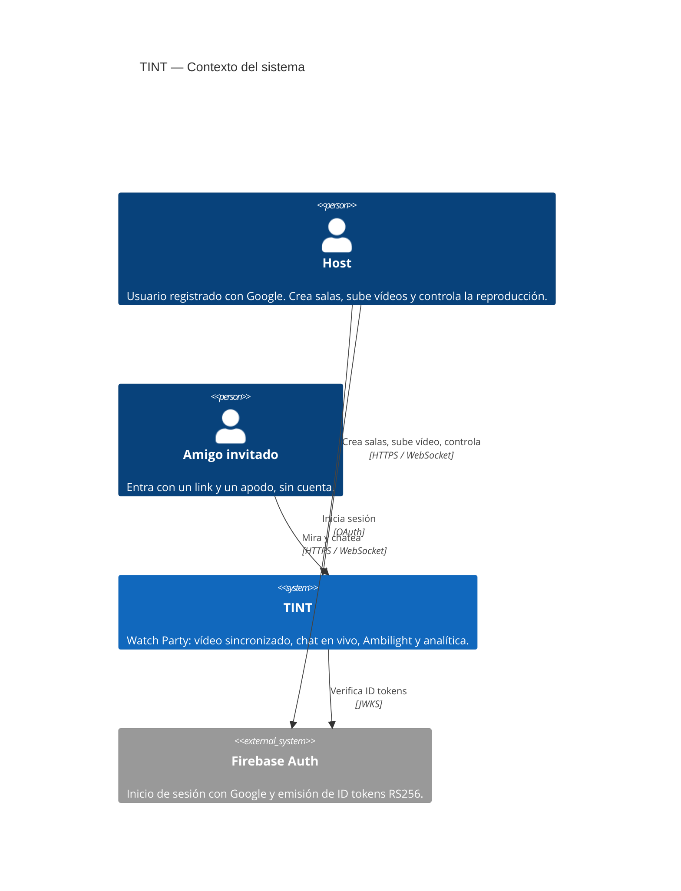
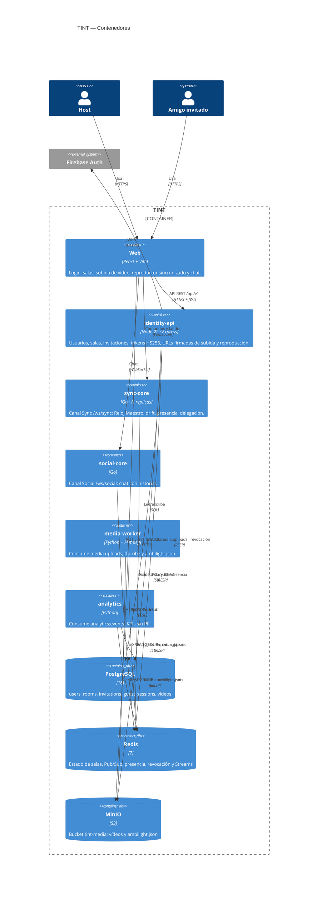
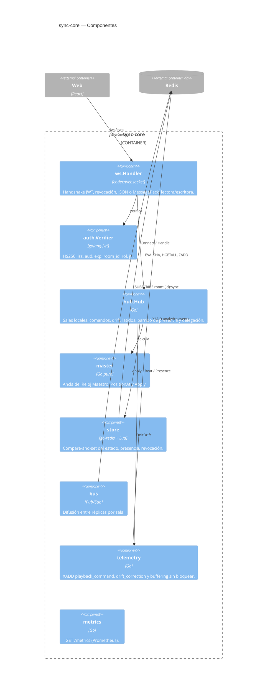
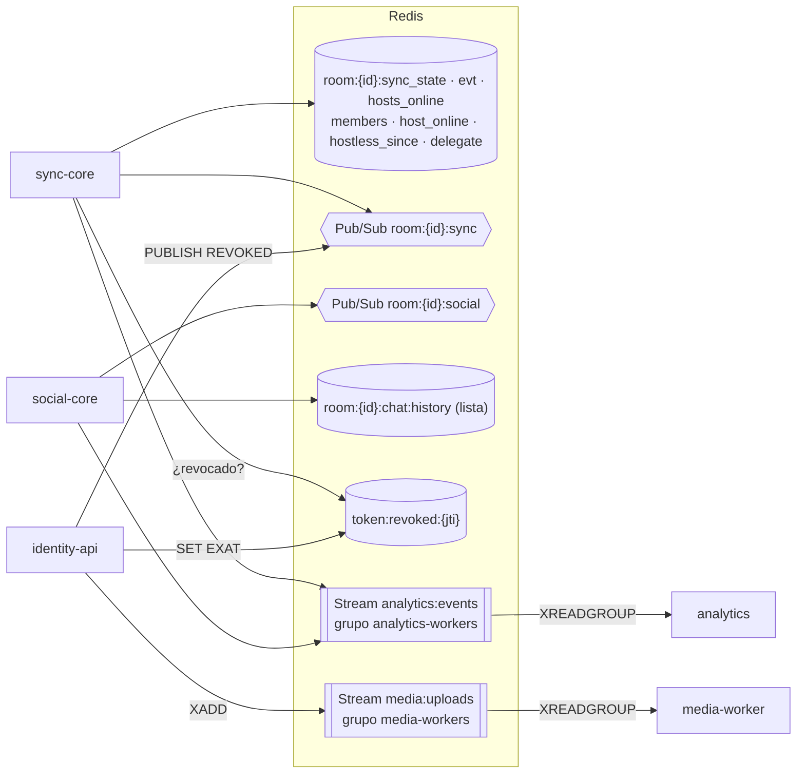
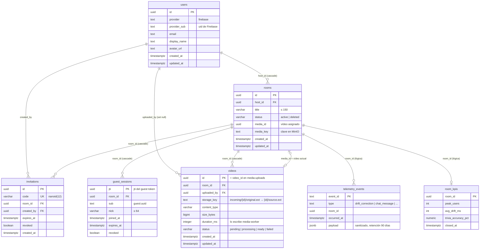

<div align="center">

# ✨ TINT — Watch Party Experience
### *Synchronized, Social & Immersive Cinema Platform*

[](https://github.com/HanamDavid/tint-monorepo/actions/workflows/ci-pipeline.yml)


<p align="center">
  <b>TINT</b> redefine la forma de ver contenido compartido en internet. Combina sincronización de vídeo de sub-segundo, iluminación ambiental <b>Ambilight</b> en vivo, mapas de calor sociales y trivias competitivas en una interfaz oscura, sobria y de lujo.
</p>

</div>

---

## 🌌 Características Principales

* 🎬 **De tu archivo a la sala en minutos:** el Host sube el vídeo **directo al Blob Storage** (MinIO) desde el navegador, y todos lo reproducen desde ahí con URLs firmadas.
* ⏱️ **Core Sync (Golang):** reproducción sincronizada por WebSockets, con Reloj Maestro en Redis y corrección automática del desfase (*drift*) por encima de 500 ms. Ver [Dominio de Reproducción](docs/dominio-reproduccion.md).
* 💬 **Chat en vivo:** canal social aislado (`/ws/social`), con historial corto en Redis y avisos de entrada y salida.
* 🌈 **Ambilight:** el media-worker extrae la paleta de los bordes del vídeo (1 FPS) y la publica junto al archivo.
* 👏 **Gamificación & Heatmaps:** reacciones con *throttling* anti-spam (máx. 5/s), histogramas de emoción y trivias con bonificación por velocidad.
* 📊 **Analítica Privacy-First:** ingesta desacoplada en Redis Streams, conforme a la Ley 1581 (nunca se guarda el texto del chat).
* 🔐 **Identidad sin fricción:** el Host entra con Google (Firebase) y los invitados se unen con un link y un apodo. El Host puede retirar invitados en vivo. Ver [Usuarios, identidad y permisos](docs/usuarios-e-identidad.md).

---

## 🛠️ Arquitectura Monorepo

| Servicio | Dominio | Tecnologías | Puerto local |
| :--- | :--- | :--- | :--- |
| [`apps/web`](apps/web) | UI/UX & Cliente Web | React, TypeScript, Tailwind CSS, Vitest | 5173 |
| [`services/identity-api`](services/identity-api) | Usuarios, salas, invitaciones, tokens y subida de vídeo | TypeScript, Express, PostgreSQL (Drizzle), Firebase Auth, S3 SDK | 8081 |
| [`services/social-core`](services/social-core) | Chat en vivo, reacciones y trivias | Golang, WebSockets, Redis | 8082 |
| [`services/sync-core`](services/sync-core) | Sincronización & Reloj Maestro | Golang, WebSockets (`coder/websocket`), Redis | 8083 |
| [`services/media-worker`](services/media-worker) | Inspección de vídeo & Ambilight | Python 3.11, FFmpeg/ffprobe, MinIO | — (worker) |
| [`services/analytics`](services/analytics) | Telemetría & KPIs diferidos | Python, Redis Streams (`XREADGROUP`), SQL | — (worker) |

```text
tint-monorepo/
├── .github/workflows/      # ci-pipeline.yml · cd-deploy.yml
├── apps/web/               # Frontend (React + TS + Tailwind)
├── services/
│   ├── identity-api/       # Usuarios, salas, tokens HS256 y subida de vídeo (TypeScript)
│   ├── sync-core/          # Reloj Maestro y Canal Sync (Go)
│   ├── social-core/        # Chat, reacciones y trivias (Go)
│   ├── media-worker/       # ffprobe + Ambilight (Python + FFmpeg)
│   └── analytics/          # Analítica & insights (Python + SQL)
├── docs/                   # Documentación de features (diagramas Mermaid)
├── scripts/                # Utilidades de CI (gate de cobertura Go)
├── docker-compose.yml      # PostgreSQL, Redis, MinIO, social-core y sync-core
├── Makefile
└── AGENTS.md               # Guía raíz → cada dominio tiene su propio AGENTS.md
```

---

## 🏛️ Arquitectura C4

### Nivel 1 — Contexto



### Nivel 2 — Contenedores



### Nivel 3 — Componentes de sync-core



Detalle de servicios, contratos y estado en [docs/arquitectura.md](docs/arquitectura.md).

---

## 🎬 Flujo completo: subir, reproducir y ver en vivo con amigos

```mermaid
sequenceDiagram
    autonumber
    actor H as Host
    actor A as Amigo
    participant W as Web
    participant FB as Firebase
    participant ID as identity-api
    participant PG as PostgreSQL
    participant MI as MinIO (Blob)
    participant R as Redis
    participant MW as media-worker
    participant SC as sync-core
    participant SO as social-core

    rect rgb(30, 41, 59)
    Note over H,PG: 1 · Sesión y sala
    H->>W: Iniciar sesión con Google
    W->>FB: signInWithPopup
    FB-->>W: ID token (RS256)
    W->>ID: POST /auth/verify
    ID->>PG: upsert users
    H->>W: Crear sala "Noche de cine"
    W->>ID: POST /rooms
    ID->>PG: INSERT rooms + invitations
    ID-->>W: room + link /invite/:code
    end

    rect rgb(20, 50, 40)
    Note over H,MW: 2 · Subida directa al Blob Storage
    H->>W: Elige el archivo de vídeo
    W->>ID: POST /rooms/:id/media/uploads {filename, contentType, sizeBytes}
    ID->>PG: INSERT videos (status pending)
    ID-->>W: uploadUrl (PUT firmado) + videoId
    W->>MI: PUT incoming/{videoId}/original.mp4 (staging, con progreso)
    W->>ID: POST /rooms/:id/media/uploads/:videoId/complete
    ID->>MI: HEAD (¿llegó? ¿tamaño correcto?)
    ID->>PG: videos.status pending → processing
    ID->>R: XADD media:uploads video_id
    ID->>PG: rooms.media_id = videoId
    ID-->>W: mediaId
    R-->>MW: XREADGROUP (grupo media-workers)
    MW->>MI: descarga incoming/{videoId}/original.mp4
    MW->>MW: ffprobe + paleta Ambilight
    MW->>MI: PUT {videoId}/source.mp4 + {videoId}/ambilight.json
    MW->>PG: status ready, duration_ms, storage_key publicado
    MW->>R: XACK
    end

    rect rgb(50, 35, 20)
    Note over H,SC: 3 · Sala en vivo
    W->>ID: POST /rooms/:id/sync-ticket
    ID-->>W: ticket HS256 (role host)
    W->>SC: WebSocket /ws/sync (ticket)
    SC->>R: Init sync_state · presencia
    SC-->>W: STATE {can_control: true}
    W->>SC: LOAD {media_id}
    SC->>R: CAS Lua + PUBLISH room:{id}:sync
    A->>W: Abre /invite/:code y escribe su apodo
    W->>ID: POST /invitations/claim
    ID->>PG: INSERT guest_sessions
    ID-->>W: guest token (role participant)
    W->>ID: GET /rooms/:id/playback
    ID-->>W: URL GET firmada + status + ambilightUrl
    W->>MI: GET vídeo (streaming)
    W->>SC: WebSocket /ws/sync (guest token)
    SC-->>W: STATE {media_id, posición, can_control: false}
    W->>SO: WebSocket /ws/social
    end

    rect rgb(45, 25, 45)
    Note over H,SO: 4 · Reproducción sincronizada y chat
    H->>W: ▶ Play
    W->>SC: PLAY {position_ms}
    SC->>R: CAS + PUBLISH
    R-->>SC: todas las réplicas
    SC-->>W: PLAY a Host y Amigo (< 100 ms)
    loop cada 1 s
        SC-->>W: HEARTBEAT {rtt_ms, drift_ms}
        W->>SC: SYNC_CHECK {posición}
        SC-->>W: SYNC_CORRECTION si drift > 500 ms
        SC->>R: XADD analytics:events (drift_correction)
    end
    A->>W: "¡Qué escena!"
    W->>SO: mensaje de chat
    SO->>R: LPUSH historial + PUBLISH room:{id}:social
    SO-->>W: chat a todos
    end
```



| Paso | Quién lo hace | Qué guarda o publica |
| :--- | :--- | :--- |
| Sesión del Host | web + Firebase + identity-api | `users` (PostgreSQL) |
| Crear sala e invitación | identity-api | `rooms`, `invitations` |
| Subir vídeo | web → **MinIO directo** (PUT firmado por identity-api) | original en `incoming/{videoId}/original.*` (staging, caduca a los 2 días), fila `videos` (pending) |
| Confirmar subida | identity-api | `videos.status` processing, `XADD media:uploads`, `rooms.media_id` |
| Procesar vídeo | media-worker | Si es válido publica `{videoId}/source.*` y `{videoId}/ambilight.json`; `videos.status` ready/failed, `duration_ms`, `storage_key` |
| Unirse con el link | identity-api | `guest_sessions`, guest token |
| Reproducir | web ← **MinIO** (GET firmado de `videos.storage_key`: el original mientras se procesa, la versión publicada al quedar ready; un vídeo failed no se sirve) | — |
| Sincronizar | sync-core | `room:{id}:sync_state`, Pub/Sub `room:{id}:sync` |
| Chatear | social-core | `room:{id}:chat:history`, Pub/Sub `room:{id}:social` |
| Medir | sync-core / social-core → analytics | Stream `analytics:events` |

> [!NOTE]
> El vídeo se reproduce desde el original en cuanto se confirma la subida. El procesamiento (`processing → ready`) solo agrega duración y Ambilight; la web muestra su estado.

---

## 🧠 Redis en TINT



| Clave / canal | Tipo | Productor → consumidor | Vida |
| :--- | :--- | :--- | :--- |
| `room:{id}:sync_state` | Hash | sync-core (CAS Lua) | 12 h desde la última actividad |
| `room:{id}:evt:{event_id}` | String | sync-core (idempotencia) | 1 min |
| `room:{id}:sync` | Pub/Sub | sync-core ↔ réplicas; identity-api publica `REVOKED` | efímero |
| `room:{id}:hosts_online`, `room:{id}:members` | ZSET | sync-core (barrido, latido = score) | 12 h; cuentan 5 s |
| `room:{id}:host_online`, `room:{id}:hostless_since`, `room:{id}:delegate` | String | sync-core | 12 h |
| `token:revoked:{jti}` | String | identity-api → sync-core e identity-api | hasta la expiración del token |
| `room:{id}:chat:history` | Lista | social-core | historial corto con TTL |
| `room:{id}:social` | Pub/Sub | social-core ↔ réplicas | efímero |
| `media:uploads` | Stream | identity-api → media-worker (`XACK`) | hasta procesarse |
| `analytics:events` | Stream | sync-core, social-core → analytics | `MAXLEN ~100000` |

---

## 👤 Usuarios y Roles

| Rol | Quién es | Cómo se autentica | Qué puede hacer |
| :--- | :--- | :--- | :--- |
| **Host** | Usuario registrado, dueño de la sala | Google vía Firebase (ID token RS256) + *sync-ticket* HS256 para el Canal Sync | Crear, renombrar y borrar salas; invitar; subir y asignar el vídeo; controlar la reproducción; retirar invitados |
| **Cohost** | Usuario registrado con permiso de control | *Previsto:* sync-core ya acepta `role: cohost`, pero aún no se emite | Controlar la reproducción |
| **Invitado** | Anónimo, con un apodo | *Guest token* HS256 (4 h) al reclamar `/invite/:code` | Ver la sala sincronizada y chatear |
| **Invitado con control delegado** | Un invitado elegido por sync-core si el Host no vuelve en 5 min | Su mismo guest token | Controlar la reproducción hasta que vuelva el Host |

Esquemas de tokens, matriz de permisos y flujos de login, invitación y retiro en **[docs/usuarios-e-identidad.md](docs/usuarios-e-identidad.md)**. El modelo de datos completo está en el [ERD al final](#️-modelo-de-datos-erd).

---

## 📚 Documentación

| Documento | Contenido |
| :--- | :--- |
| [docs/arquitectura.md](docs/arquitectura.md) | Servicios, almacenes de datos, contratos entre dominios, puertos y CI |
| [docs/usuarios-e-identidad.md](docs/usuarios-e-identidad.md) | Roles, permisos, esquema de PostgreSQL, tokens y flujos de identidad |
| [docs/dominio-reproduccion.md](docs/dominio-reproduccion.md) | Canal Sync v2: Reloj Maestro, drift, presencia, delegación, subida de vídeo, métricas y pruebas |
| [AGENTS.md](AGENTS.md) | Reglas del monorepo, contratos compartidos, flujo de trabajo y gates por dominio |

> [!TIP]
> Cada dominio incluye un `AGENTS.md` con su stack, responsabilidades, límites, modelo de datos y reglas TDD. Léelo antes de contribuir (humano o agente IA).

---

## 🚀 Inicio Rápido en Local

**Requisitos:** Docker, Go 1.22+, Python 3.11+, Node.js 22+ y FFmpeg (para el media-worker fuera de Docker).

```bash
# 1. Clonar y levantar todo (PostgreSQL, Redis, MinIO + bucket, identity-api :8081 con sus
#    migraciones, web :5173, media-worker, analytics :8084, social-core :8082, sync-core :8083)
git clone https://github.com/HanamDavid/tint-monorepo.git && cd tint-monorepo
cp .env.example .env            # completa VITE_FIREBASE_* y FIREBASE_PROJECT_ID
docker compose up -d --build    # si cambias VITE_*, vuelve a ejecutarlo: se incrustan al compilar

# 2. Desarrollo con recarga (opcional): detén el contenedor y corre el servicio local
#    cd services/identity-api && cp .env.example .env && npm ci && npm run dev
#    cd apps/web && cp .env.example .env && npm ci && npm run dev

# 3. media-worker: ya corre en docker compose (`docker logs -f tint-media-worker`).
#    Para desarrollarlo fuera de Docker: pip install -r requirements-dev.txt y
#    DATABASE_URL=… S3_ACCESS_KEY=… S3_SECRET_KEY=… PYTHONPATH=src python -m media_worker

# 4. Suite global de pruebas (TDD Policy Check) y flujo completo contra la infraestructura real
make test-all
cd services/identity-api && WAIT_WORKER=1 npm run test:integration
```

> [!IMPORTANT]
> Sin el media-worker el vídeo se reproduce igual desde el original de `incoming/`, pero queda en `processing` y sin Ambilight. Si el worker lo rechaza (archivo corrupto) queda `failed` y no se sirve.

| Servicio local | URL |
| :--- | :--- |
| web | `http://localhost:5173` |
| identity-api | `http://localhost:8081/api/v1` |
| social-core (Canal Social) | `ws://localhost:8082/ws/social` |
| sync-core (Canal Sync) | `ws://localhost:8083/ws/sync` · `/healthz` · `/metrics` (Prometheus) |
| PostgreSQL | `localhost:5432` |
| Redis | `localhost:6379` |
| MinIO API / Consola | `localhost:9000` / [`localhost:9001`](http://localhost:9001) |

> [!NOTE]
> `JWT_SECRET` (en `.env`) debe ser el mismo para identity-api, sync-core y social-core: identity-api firma los tokens y los canales los verifican. MinIO acepta peticiones del navegador desde `MINIO_CORS_ALLOW_ORIGIN` (por defecto `http://localhost:5173`).

---

## 🧪 Política TDD y Cobertura

> [!IMPORTANT]
> Todo cambio en la plataforma exige metodología TDD (Red → Green → Refactor) y una cobertura de pruebas automatizadas **≥ 85%**. Los Pull Requests sin pruebas suficientes son rechazados automáticamente por el pipeline de CI.

El workflow [`ci-pipeline.yml`](.github/workflows/ci-pipeline.yml) se ejecuta en cada push y PR hacia `main` y `develop`, en paralelo:

| Job | Comando | Gate |
| :--- | :--- | :--- |
| Go (`sync-core`, `social-core`) | `go test -race -coverprofile=coverage.out ./...` | `scripts/check-go-coverage.sh` |
| Python (`media-worker`, `analytics`) | `pytest --cov=src` | `--cov-fail-under=85` |
| Web (`apps/web`) | `vitest run --coverage` | `thresholds` en `vitest.config.ts` |
| Node (`identity-api`) | `npm ci` · `tsc` · `vitest run --coverage` | `thresholds` en `vitest.config.ts` |
| k6 (`sync-core`) | 50 conexiones reales contra sync-core + Redis | p99 de retransmisión < 100 ms, drift y autorización |

El job **`CI Gate`** agrega el resultado de todos los anteriores y es el *status check* requerido por la protección de ramas: si cualquier servicio falla o baja del 85%, el merge queda bloqueado.

---

## 🤝 Contribución

1. Lee el [AGENTS.md](AGENTS.md) raíz y el del dominio.
2. Crea una rama desde `develop`: `feat/<dominio>-<descripcion>`.
3. Escribe la prueba primero (TDD), luego implementa y corre el gate del dominio.
4. Commits con [Conventional Commits](https://www.conventionalcommits.org/es/v1.0.0/): `feat(sync-core): ...`, `fix(identity-api): ...`, `docs(web): ...`, `ci: ...`.
5. Si cambió un flujo o un contrato, actualiza [`docs/`](docs/README.md).
6. Abre un PR hacia `develop` y completa la plantilla.

---

## 🗄️ Modelo de datos (ERD)

Todas las tablas del sistema. `users`, `rooms`, `invitations`, `guest_sessions` y `videos` las crean las migraciones de identity-api (`services/identity-api/migrations`). `videos` la actualiza además media-worker. `telemetry_events` y `room_kpis` son de analytics (definidas en su [AGENTS.md](services/analytics/AGENTS.md), aún sin migración).



## 📄 Licencia

Distribuido bajo licencia [MIT](LICENSE).
