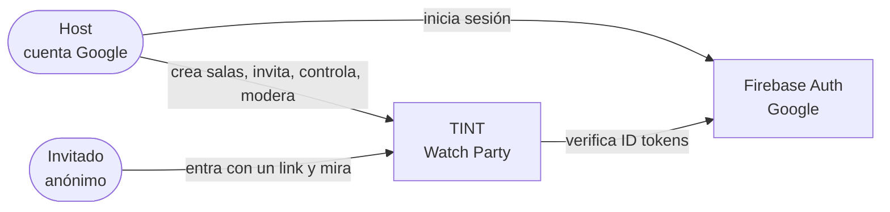
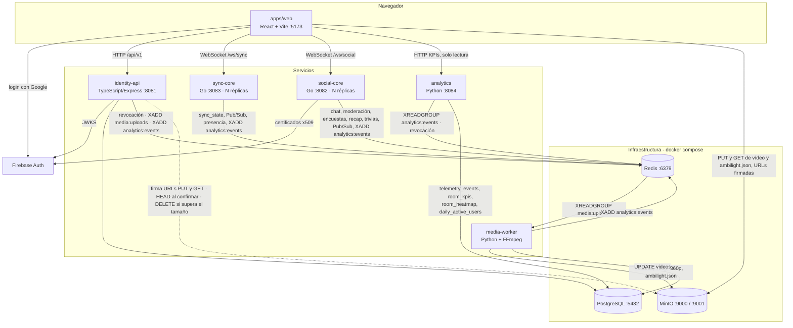
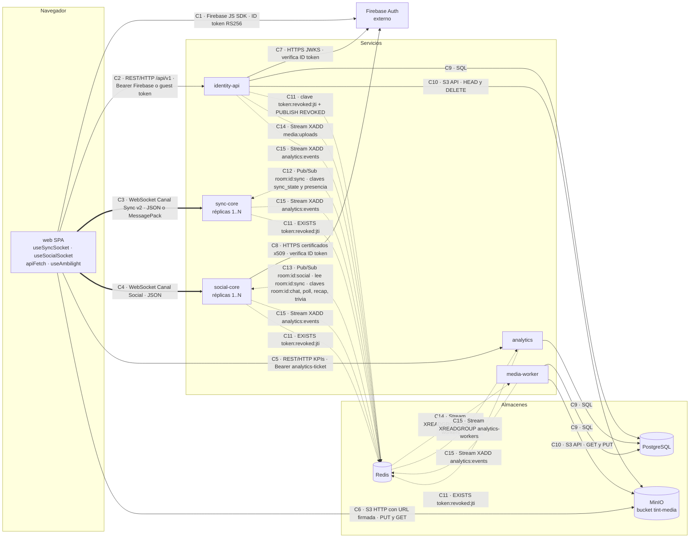
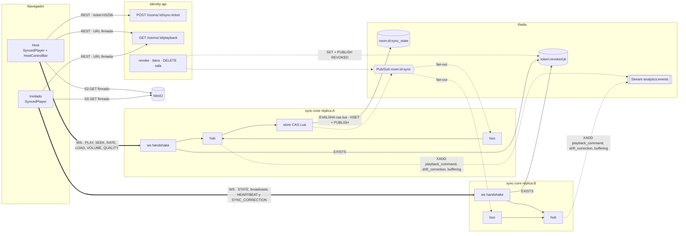
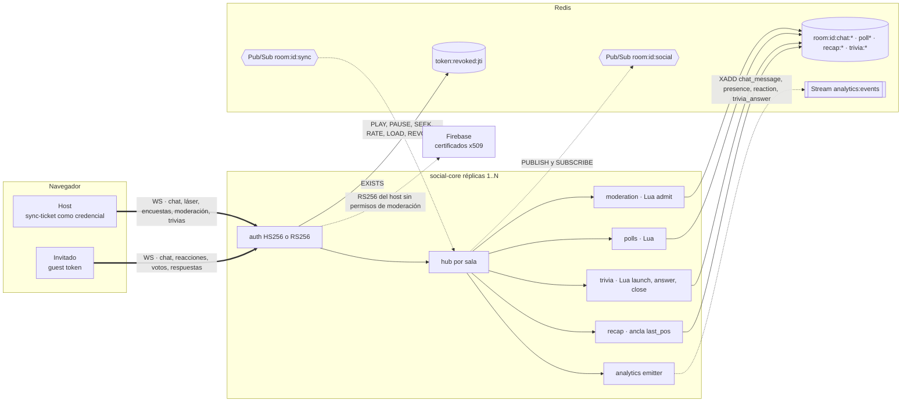
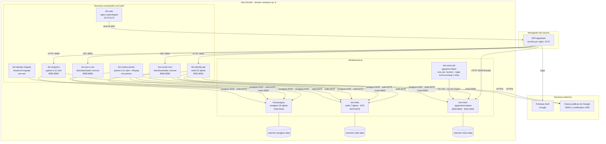
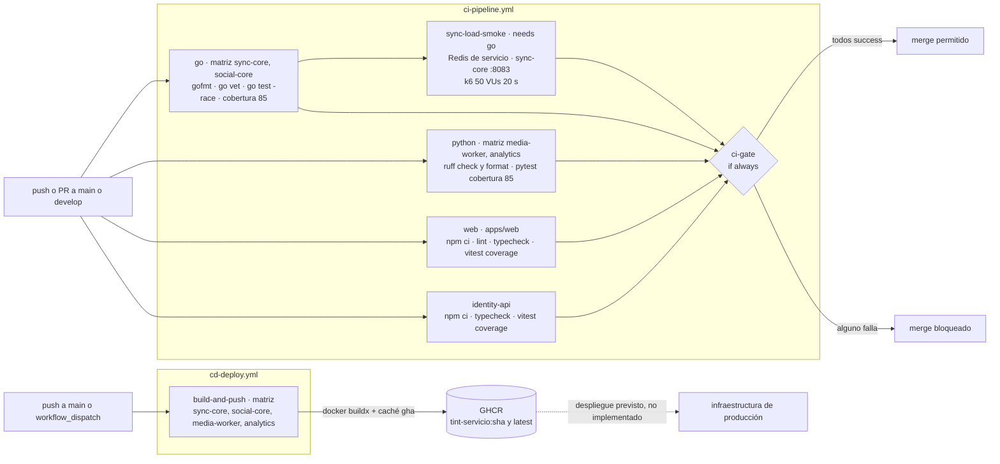

# 🏛️ Arquitectura del sistema

> Vista general de TINT: servicios, componentes y conectores, almacenes de datos, contratos compartidos, despliegue y estado de implementación.
> Los detalles de cada feature están en sus propios documentos (ver [índice](README.md)) y las decisiones de arquitectura, en los [ADRs](adr/README.md).

## Índice
1. [Contexto](#1-contexto)
2. [Contenedores](#2-contenedores)
3. [Servicios y estado](#3-servicios-y-estado)
4. [Vista de componentes y conectores (C&C)](#4-vista-de-componentes-y-conectores-cc)
5. [Contratos compartidos entre dominios](#5-contratos-compartidos-entre-dominios)
6. [Almacenes de datos](#6-almacenes-de-datos)
7. [Vista de despliegue](#7-vista-de-despliegue)
8. [Puertos locales](#8-puertos-locales)
9. [Calidad, CI y CD](#9-calidad-ci-y-cd)
10. [Decisiones de arquitectura (ADRs)](#10-decisiones-de-arquitectura-adrs)
11. [Documentación por servicio](#11-documentación-por-servicio)

## 1. Contexto

## 2. Contenedores

## 3. Servicios y estado

| Servicio | Responsabilidad | Estado | Guía |
| :--- | :--- | :--- | :--- |
| `apps/web` | UI: login, dashboard, gestión de salas, invitación, biblioteca y subida de vídeo, reproductor sincronizado con barra del host (volumen, calidad, velocidad), puntero láser, Ambilight, chat con moderación y spoilers, encuestas, trivia, recap, bloqueo de invitados y analítica de la sala | ✅ Implementado (UI nueva con `framer-motion`, logo SVG, Ambilight y láser) | [README](../apps/web/README.md) · [AGENTS](../apps/web/AGENTS.md) |
| `services/identity-api` | Usuarios, salas (renombrar, borrado lógico), invitaciones, tokens (guest token, sync-ticket, analytics-ticket), subida y reproducción de vídeo, biblioteca `GET /videos`, invitados (retirar y bloquear por dispositivo con `room_bans`) | ✅ Implementado | [README](../services/identity-api/README.md) · [AGENTS](../services/identity-api/AGENTS.md) |
| `services/sync-core` | Reloj Maestro, Canal Sync v2 (`PLAY`/`PAUSE`/`SEEK`/`RATE`/`LOAD`/`VOLUME`/`QUALITY`), drift, presencia, delegación, revocación, métricas | ✅ Implementado (v2) | [README](../services/sync-core/README.md) · [AGENTS](../services/sync-core/AGENTS.md) |
| `services/social-core` | Chat en vivo (`/ws/social`) con moderación (modo lento y silencio) y spoilers, reacciones, puntero láser, encuestas, recap y trivias con rankings | 🟢 Chat, moderación, spoilers, reacciones, láser, encuestas, recap y trivias implementados. Heatmap: solo los buckets de 5 s en memoria (`internal/reactions/buckets.go`); las claves `room:{id}:heatmap` y `video:{id}:heatmap:history` y el evento de heatmap en vivo cada 1 s están **previstos**. La retransmisión de Ambilight en vivo también está **prevista** (hoy la web descarga `ambilight.json` por HTTP) | [README](../services/social-core/README.md) · [AGENTS](../services/social-core/AGENTS.md) |
| `services/media-worker` | Consume `media:uploads`: valida con `ffprobe`, normaliza a MP4 H.264 + AAC, extrae el Ambilight, publica el vídeo, las calidades 720p/360p y `ambilight.json`; estado de `videos`; publica `media_processed` | ✅ Implementado (servicio de docker compose, verificado de punta a punta) | [README](../services/media-worker/README.md) · [AGENTS](../services/media-worker/AGENTS.md) |
| `services/analytics` | Ingesta de `analytics:events`, sanitización, KPIs por sala, retención de 90 días y API de solo lectura de KPIs, heatmap de reacciones y línea de tiempo para el host | ✅ Implementado (consumidor, migraciones y API; servicio de docker compose) | [README](../services/analytics/README.md) · [AGENTS](../services/analytics/AGENTS.md) · [contrato de eventos](contrato-eventos-analitica.md) |

## 4. Vista de componentes y conectores (C&C)

Muestra los componentes **en tiempo de ejecución** y los conectores por los que interactúan. Cada conector está rotulado con su tipo y protocolo. Ancla estable para enlazar esta vista: `arquitectura.md#vista-de-componentes-y-conectores`.

> social-core **no** tiene heatmap en vivo ni retransmisión de Ambilight (solo `reactions.Buckets` en memoria y los buckets de 5 s del recap en Redis), y no expone `/metrics`: solo sync-core lo hace.

**Leyenda**

| Trazo | Significado |
| :--- | :--- |
| `──▶` línea continua | Petición/respuesta **síncrona** (HTTP, SQL, S3) |
| `══▶` línea gruesa | Conexión **WebSocket** persistente y bidireccional |
| `- -▶` línea punteada | Interacción **asíncrona** o por estado compartido a través de Redis (Pub/Sub, Streams, claves) |
| `( )` cilindro | Almacén de datos |
| `Cn` | Identificador del conector en la tabla de abajo |

### 4.1 Tabla de conectores

| Id | Tipo | Origen → destino | Protocolo | Sincronía | Contrato o fuente de verdad |
| :--- | :--- | :--- | :--- | :--- | :--- |
| C1 | Autenticación externa | web → Firebase Auth | Firebase JS SDK (`signInWithPopup`), ID token RS256 | Síncrono | [usuarios-e-identidad §4](usuarios-e-identidad.md#4-esquemas-de-tokens) |
| C2 | REST | web → identity-api | HTTP/JSON `/api/v1`, `Authorization: Bearer` (ID token de Firebase o guest token) | Síncrono | [identity-api/AGENTS.md § API](../services/identity-api/AGENTS.md#api) |
| C3 | WebSocket Canal Sync v2 | web ↔ sync-core | `GET /ws/sync?room_id&token`; JSON o MessagePack (`tint.sync.msgpack`); cierres terminales `4001`/`4003` | Asíncrono bidireccional (latido 1 s) | [sync-core/AGENTS.md § Protocolo](../services/sync-core/AGENTS.md#protocolo-del-canal-sync) · [dominio-reproduccion](dominio-reproduccion.md) |
| C4 | WebSocket Canal Social | web ↔ social-core | `GET /ws/social?room_id&token` (o `Authorization`); JSON; ping cada 20 s | Asíncrono bidireccional | [social-core/AGENTS.md § Protocolo](../services/social-core/AGENTS.md#protocolo-del-canal-social) |
| C5 | REST de solo lectura | web → analytics | HTTP/JSON `GET /api/v1/rooms/{id}/kpis`, `/reactions/heatmap`, `/timeline`; Bearer `analytics-ticket`; CORS | Síncrono | [analytics/AGENTS.md § API](../services/analytics/AGENTS.md#api-solo-lectura-puerto-analytics_port-por-defecto-8084) |
| C6 | S3 con URL firmada | web → MinIO | HTTP `PUT` (subida a `incoming/{id}/original.*`) y `GET` (vídeo, calidades, `ambilight.json`) con firma SigV4 calculada por identity-api | Síncrono | [dominio-reproduccion §6.7](dominio-reproduccion.md#67-subida-y-cambio-de-vídeo) |
| C7 | Verificación de token | identity-api → Google | HTTPS JWKS `securetoken@system.gserviceaccount.com` (`jwks-rsa`, en caché) | Síncrono (con caché) | [usuarios-e-identidad §4](usuarios-e-identidad.md#4-esquemas-de-tokens) |
| C8 | Verificación de token | social-core → Google | HTTPS certificados x509 públicos por `kid` (caché por `Cache-Control`) | Síncrono (con caché) | [social-core/AGENTS.md § Autenticación](../services/social-core/AGENTS.md#autenticación-de-wssocial) |
| C9 | SQL | identity-api, media-worker, analytics → PostgreSQL | Drizzle ORM (identity-api), `psycopg` 3 (Python) | Síncrono | [usuarios-e-identidad §3](usuarios-e-identidad.md#3-esquema-de-datos-postgresql) · [analytics/AGENTS.md](../services/analytics/AGENTS.md#modelo-de-datos-involucrado) |
| C10 | S3 API | identity-api, media-worker → MinIO | `@aws-sdk/client-s3` (HEAD, DELETE) · `boto3` (GET, PUT) | Síncrono | [media-worker/AGENTS.md](../services/media-worker/AGENTS.md#modelo-de-datos-involucrado) |
| C11 | Clave Redis + Pub/Sub | identity-api → sync-core, social-core, analytics | `SET token:revoked:{jti} 1 EXAT exp` + `PUBLISH room:{id}:sync REVOKED{jti}`; los consumidores hacen `EXISTS` en el handshake o en cada petición | Asíncrono (aviso) + consulta síncrona | [dominio-reproduccion §6.6](dominio-reproduccion.md#66-retirar-a-un-invitado-f5) · [ADR 0007](adr/0007-revocacion-por-clave-redis-y-cierre-4001.md) |
| C12 | Redis Pub/Sub + claves | sync-core ↔ sync-core (réplicas) | `room:{id}:sync` (JSON), CAS Lua sobre `room:{id}:sync_state`, ZSET de presencia | Asíncrono (fan-out) | [dominio-reproduccion §7](dominio-reproduccion.md#7-modelo-de-datos-en-redis) · [ADR 0003](adr/0003-redis-pubsub-para-fanout-entre-replicas.md) |
| C13 | Redis Pub/Sub + claves | social-core ↔ social-core; sync-core → social-core (solo lectura) | `room:{id}:social` (dedup por `event_id`); suscripción de solo lectura a `room:{id}:sync` (comandos para recap y trivias, `REVOKED`) | Asíncrono | [social-core/AGENTS.md § Modelo de datos](../services/social-core/AGENTS.md#modelo-de-datos-involucrado) |
| C14 | Redis Stream | identity-api → media-worker | `XADD media:uploads * video_id <id>` → `XREADGROUP` grupo `media-workers` + `XACK` | Asíncrono (cola) | [dominio-reproduccion §6.7](dominio-reproduccion.md#67-subida-y-cambio-de-vídeo) · [ADR 0009](adr/0009-procesamiento-asincrono-con-redis-streams.md) |
| C15 | Redis Stream | identity-api, sync-core, social-core, media-worker → analytics | `XADD analytics:events MAXLEN ~ 100000` → `XREADGROUP` grupo `analytics-workers` + `XACK` tras el commit | Asíncrono, best-effort | [contrato-eventos-analitica](contrato-eventos-analitica.md) · [ADR 0010](adr/0010-eventos-de-analitica-sin-pii.md) |

### 4.2 C&C del flujo de reproducción

### 4.3 C&C del flujo social

## 5. Contratos compartidos entre dominios

Son los únicos puntos en los que un PR puede necesitar coordinar dos dominios (regla 1 de [AGENTS.md](../AGENTS.md)). Si se cambia uno, hay que actualizar **ambos lados y este documento**.

| Contrato | Productor → consumidor | Definición |
| :--- | :--- | :--- |
| JWT HS256 (guest token, sync-ticket, analytics-ticket) | identity-api → sync-core, social-core, analytics | [usuarios-e-identidad §4](usuarios-e-identidad.md#4-esquemas-de-tokens) · `JWT_SECRET`/`JWT_ISSUER`/`JWT_AUDIENCE` iguales en los cuatro; social-core y analytics exigen `jti`, `iss`, `aud` y `exp` ([ADR 0006](adr/0006-tickets-jwt-hs256-emitidos-por-identity-api.md)) |
| Firebase ID token RS256 (host en `/ws/social`) | Firebase → social-core | Firma verificada con los certificados x509 públicos de Google por `kid`; `iss`/`aud` = `FIREBASE_PROJECT_ID` (sin él, se rechaza). No da permisos de moderación |
| Protocolo del Canal Sync v2 | sync-core ↔ web | [sync-core/AGENTS.md](../services/sync-core/AGENTS.md#protocolo-del-canal-sync) · comandos `PLAY`/`PAUSE`/`SEEK`/`RATE`/`LOAD`/`VOLUME`/`QUALITY`; `volume` ∈ [0, 1] y `quality` ∈ {`auto`, `source`, `720p`, `360p`} viajan en broadcasts, `STATE` y `SYNC_CORRECTION` ([dominio-reproduccion §6.9](dominio-reproduccion.md#69-volumen-y-calidad-del-host-f8)); `SYNC_CHECK` acepta `version` opcional (última aplicada por el cliente; compatible hacia atrás) y tiene su propio límite de 5/s ([dominio-reproduccion §6.3](dominio-reproduccion.md#63-latido-rtt-y-drift)) |
| Protocolo del Canal Social (`/ws/social`) | social-core ↔ web | [social-core/AGENTS.md](../services/social-core/AGENTS.md#protocolo-del-canal-social) · chat (con `spoiler`), reacciones, `laser_point`/`laser`, `poll_*`/`poll_state`, `recap_request`/`recap`, `chat_slow_mode`/`chat_mute`/`chat_settings`, `trivia_*`. Láser, encuestas, moderación del chat y programación de trivias exigen el **sync-ticket** del host (HS256, `role` host/cohost, `room_id` de la sala): un Firebase ID token no da permisos de moderación |
| Comandos de reproducción en `room:{id}:sync` | sync-core → social-core (solo lectura) | social-core lee `PLAY`, `PAUSE`, `SEEK`, `RATE` y `LOAD` (`event_id`, `position_ms`, `status`, `rate`, `updated_at_ms`, `version`) para contar pausas y rebobinados del recap y para disparar las trivias en su posición (proyecta con su propio reloj, no con `updated_at_ms`); deduplica por `event_id` entre réplicas ([ADR 0012](adr/0012-trivia-con-reloj-del-servidor-y-ancla-del-recap.md)) |
| Revocación (`token:revoked:{jti}` + `REVOKED`) | identity-api → sync-core, social-core, analytics, web | [dominio-reproduccion §6.6](dominio-reproduccion.md#66-retirar-a-un-invitado-f5) · sync-core y social-core leen `REVOKED` de `room:{id}:sync` y cierran con 4001; analytics consulta la clave en cada petición; retirar, bloquear (`room_bans`) y borrar la sala usan la misma vía ([ADR 0007](adr/0007-revocacion-por-clave-redis-y-cierre-4001.md), [ADR 0013](adr/0013-bloqueo-de-invitados-por-dispositivo.md)) |
| `mediaId` / `media_id` | identity-api → web → sync-core | [dominio-reproduccion §6.7](dominio-reproduccion.md#67-subida-y-cambio-de-vídeo) · con la biblioteca, `mediaId = videos.id` |
| API REST `/api/v1` | identity-api → web | [identity-api/AGENTS.md](../services/identity-api/AGENTS.md#api) (incluye `GET /videos`, `PATCH /videos/:id`, `PUT /rooms/:id/media {videoId}` y `/rooms/:id/bans`) |
| `media:uploads` + tabla `videos` | identity-api → media-worker | Evento `{video_id}`; columnas `id`, `storage_key`, `duration_ms`, `status`, `renditions`; original en `incoming/{id}/original.*`, el worker publica `{id}/source.*` y reescribe `storage_key`, y además publica las calidades `{id}/720p.mp4` y `{id}/360p.mp4` y escribe sus alturas en `renditions` (jsonb, p. ej. `[720, 360]`), que identity-api expone como `qualities` en el playback ([dominio-reproduccion §6.7](dominio-reproduccion.md#67-subida-y-cambio-de-vídeo)) |
| `analytics:events` | identity-api, social-core, sync-core, media-worker → analytics | [contrato-eventos-analitica](contrato-eventos-analitica.md) · obligatorios `event_id`, `type`, `source`, `occurred_at`, `received_at`; `room_id` en todo evento de sala; sin texto libre ni PII |
| API de lectura de analytics + `analytics-ticket` | identity-api (emite el ticket) → web → analytics | `POST /api/v1/rooms/:id/analytics-ticket` (host dueño, también con la sala cerrada) → `GET /api/v1/rooms/{id}/kpis`, `/reactions/heatmap`, `/timeline` en el puerto 8084 ([analytics/AGENTS.md](../services/analytics/AGENTS.md#api-solo-lectura-puerto-analytics_port-por-defecto-8084)) · mismos `JWT_SECRET`/`JWT_ISSUER`/`JWT_AUDIENCE`; revocación con falla cerrado |
| Puertos locales | infra ↔ web | social-core 8082, sync-core 8083, analytics 8084 (`docker-compose.yml`, `apps/web/.env.example`) |

## 6. Almacenes de datos

| Almacén | Dueño | Contenido principal |
| :--- | :--- | :--- |
| PostgreSQL | identity-api | `users`, `rooms`, `invitations`, `guest_sessions` (con `device_id`), `room_bans`, `videos` (con `renditions` y `title`) ([esquema](usuarios-e-identidad.md#3-esquema-de-datos-postgresql)); media-worker lee y actualiza `videos` (no crea filas) y lee `users.provider_sub` |
| PostgreSQL | analytics | `schema_migrations`, `telemetry_events` (90 días), `room_kpis`, `room_heatmap`, `daily_active_users` ([modelo](../services/analytics/AGENTS.md#modelo-de-datos-involucrado)) |
| Redis | sync-core | `room:{id}:sync_state`, `:evt:{event_id}`, `:hosts_online`, `:members`, `:host_online`, `:hostless_since`, `:delegate` y Pub/Sub `room:{id}:sync` ([modelo](dominio-reproduccion.md#7-modelo-de-datos-en-redis)) |
| Redis | identity-api → sync-core, social-core, analytics | `token:revoked:{jti}` |
| Redis | social-core | `room:{id}:chat:history`, `room:{id}:chat:settings`/`:muted`/`:last:{sub}` (moderación), `room:{id}:poll*` (encuestas), `room:{id}:recap:*` (métricas del recap y ancla de reproducción), `room:{id}:trivia:*` (trivias y rankings), Pub/Sub `room:{id}:social` (chat, reacciones, láser, `poll_state`, `chat_settings`, `trivia_question` y `trivia_result` entre réplicas) |
| Redis Stream | identity-api → media-worker | `media:uploads` (grupo `media-workers`) |
| Redis Stream | identity-api, social-core, sync-core, media-worker → analytics | `analytics:events` (grupo `analytics-workers`) |
| MinIO | web (PUT/GET firmados) · media-worker | Bucket `tint-media`: `incoming/{videoId}/original.*` (staging del navegador, caduca a los 2 días), `{videoId}/source.mp4`, `{videoId}/720p.mp4`, `{videoId}/360p.mp4` y `{videoId}/ambilight.json` (publicados por el worker) |

## 7. Vista de despliegue

### 7.1 Entorno local con docker compose (el único que existe hoy)

- **identity-api corre en contenedor** (`services/identity-api/Dockerfile`, multi-stage): el target `runtime` solo lleva dependencias de producción y `dist/` (tsup), con el usuario `node`. Sus migraciones las aplica el servicio `identity-migrate` (target `migrate` del mismo Dockerfile, `drizzle-kit migrate`), que termina antes de que arranque identity-api. Habla con la infraestructura por los hosts internos (`postgres`, `redis`, `minio`), pero firma las URLs del navegador con `MINIO_PUBLIC_ENDPOINT` (`http://localhost:9000`): la firma SigV4 incluye el host.
- **La web corre en contenedor** (`apps/web/Dockerfile`): Vite compila `dist/` y nginx sin privilegios lo sirve en 5173 con fallback a `index.html` para react-router. Las variables `VITE_*` se incrustan **al compilar** (build args) y son las URLs que ve el navegador; si cambian, hay que reconstruir con `docker compose up -d --build`. Es una SPA estática provisional: se reemplazará al pasar a SSR.
- **Desarrollo sin contenedores:** `npm run dev` en `services/identity-api` y `apps/web` sigue funcionando (recarga en caliente); en ese caso detén el contenedor equivalente para liberar el puerto.
- **Orden de arranque** (`depends_on`): `minio-init` espera a que MinIO esté sano; `media-worker` espera a PostgreSQL y Redis sanos y a que `minio-init` termine bien; `analytics`, `social-core` y `sync-core` esperan a Redis (analytics también a PostgreSQL). analytics aplica sus migraciones al arrancar.
- **Salud y métricas:** los cuatro servicios de compose exponen `/healthz` (media-worker no tiene HTTP); solo sync-core expone `/metrics` (Prometheus). social-core no tiene `/metrics`.
- **Réplicas:** compose levanta **una** réplica de cada servicio. El diseño soporta N réplicas de sync-core y social-core (Pub/Sub, CAS y `HSETNX` entre réplicas), pero no hay balanceador ni configuración multirréplica en el repositorio.

| Nodo | Artefacto | Puertos (host → contenedor) | Volúmenes | Variables principales |
| :--- | :--- | :--- | :--- | :--- |
| `tint-postgres` | Imagen `postgres:16-alpine` | 5432 → 5432 | `postgres-data:/var/lib/postgresql/data` | `POSTGRES_USER`, `POSTGRES_PASSWORD`, `POSTGRES_DB` |
| `tint-redis` | Imagen `redis:7-alpine` (`--appendonly yes`) | 6379 → 6379 | `redis-data:/data` | — |
| `tint-minio` | Imagen `pgsty/minio:latest` (la oficial no está disponible) | 9000 → 9000 (API) · 9001 → 9001 (consola) | `minio-data:/data` | `MINIO_ROOT_USER`, `MINIO_ROOT_PASSWORD`, `MINIO_API_CORS_ALLOW_ORIGIN` (de `MINIO_CORS_ALLOW_ORIGIN`) |
| `tint-minio-init` | Imagen `pgsty/mc:latest`, se ejecuta una vez | — | — | `MINIO_ROOT_USER`, `MINIO_ROOT_PASSWORD`, `MINIO_BUCKET` |
| `tint-media-worker` | `build: ./services/media-worker` (`python:3.11-slim` + `ffmpeg`, usuario `worker`, `python -m media_worker`) | — | — | `DATABASE_URL`, `REDIS_URL`, `S3_ENDPOINT_URL`, `S3_ACCESS_KEY`, `S3_SECRET_KEY`, `MINIO_BUCKET`, `MEDIA_WORKER_CONSUMER` |
| `tint-analytics` | `build: ./services/analytics` (`python:3.11-slim`, usuario `worker`, `python -m analytics`) | `ANALYTICS_PORT` (8084) → 8084 | — | `DATABASE_URL`, `REDIS_URL`, `JWT_SECRET`, `JWT_ISSUER`, `JWT_AUDIENCE`, `ANALYTICS_PORT`, `ANALYTICS_ALLOWED_ORIGINS`, `ANALYTICS_CONSUMER` |
| `tint-social-core` | `build: ./services/social-core` (multi-stage `golang:1.22-alpine` → `distroless/static-debian12:nonroot`) | 8082 → 8082 | — | `SOCIAL_CORE_ADDR`, `REDIS_URL`, `JWT_*`, `FIREBASE_PROJECT_ID`, `ALLOWED_ORIGINS` (de `SOCIAL_ALLOWED_ORIGINS`) |
| `tint-sync-core` | `build: ./services/sync-core` (multi-stage `golang:1.22-alpine` → `distroless/static-debian12:nonroot`) | 8083 → 8080 | — | `SYNC_CORE_ADDR`, `REDIS_URL`, `JWT_*`, `ALLOWED_ORIGINS` (de `SYNC_ALLOWED_ORIGINS`) |
| `tint-identity-migrate` | `build: ./services/identity-api` (`target: migrate`, `node:22-alpine`), se ejecuta una vez | — | — | `DATABASE_URL` |
| `tint-identity-api` | `build: ./services/identity-api` (`target: runtime`, `node:22-alpine`, usuario `node`, `node dist/server.js`) | 8081 → 8081 | — | `IDENTITY_API_PORT`, `DATABASE_URL`, `REDIS_URL`, `JWT_*`, `FIREBASE_PROJECT_ID`, `MINIO_ENDPOINT`, `MINIO_PUBLIC_ENDPOINT`, `MINIO_ACCESS_KEY`, `MINIO_SECRET_KEY`, `MINIO_BUCKET` (resto de `services/identity-api/.env.example` con su valor por defecto) |
| `tint-web` | `build: ./apps/web` (Vite → `nginxinc/nginx-unprivileged:1.27-alpine`) | 5173 → 5173 | — | Build args `VITE_IDENTITY_API_URL`, `VITE_SYNC_WS_URL`, `VITE_SOCIAL_WS_URL`, `VITE_ANALYTICS_API_URL`, `VITE_FIREBASE_*` (también `VITE_SYNC_ENCODING` y `VITE_DEMO_VIDEO_URL` en el Dockerfile) |
| Firebase Auth | Servicio externo de Google | HTTPS | — | `FIREBASE_PROJECT_ID` (identity-api, social-core), `VITE_FIREBASE_*` (web) |

Los valores por defecto de compose salen del [`.env.example` raíz](../.env.example). `JWT_SECRET`, `JWT_ISSUER` y `JWT_AUDIENCE` deben ser idénticos en identity-api, sync-core, social-core y analytics.

### 7.2 Producción

**No hay despliegue a producción en el repositorio.** Lo único que existe es el workflow [`cd-deploy.yml`](../.github/workflows/cd-deploy.yml): en cada `push` a `main` (o a mano) construye y publica en GHCR las imágenes `ghcr.io/<owner>/tint-{sync-core,social-core,media-worker,analytics}` con las etiquetas `sha` y `latest`. El propio archivo dice que el despliegue a infraestructura (Kubernetes o VM) "se añadirá en una HU posterior". **identity-api y la web no tienen imagen** y no se publican. Pendientes que ya están documentados para producción: `/metrics` de sync-core detrás del ingress, hash tags de Redis para un cluster y el índice de `guest_sessions.room_id` ([dominio-reproduccion §16](dominio-reproduccion.md#16-limitaciones-conocidas)).

### 7.3 Pipeline de CI y CD

## 8. Puertos locales

| Servicio | Puerto | Notas |
| :--- | :--- | :--- |
| web | 5173 | `docker compose` (nginx); `npm run dev` para desarrollo |
| identity-api | 8081 | `docker compose` (`/api/v1/healthz`); `npm run dev` para desarrollo |
| social-core | 8082 | `docker compose` (`/ws/social`, `/healthz`) |
| sync-core | 8083 → 8080 | `docker compose` (`/ws/sync`, `/healthz`, `/metrics`) |
| analytics | 8084 | `docker compose` (`/healthz`, `/api/v1/rooms/{id}/kpis`, `/reactions/heatmap`, `/timeline`) |
| PostgreSQL | 5432 | |
| Redis | 6379 | |
| MinIO | 9000 (API) · 9001 (consola) | |

## 9. Calidad, CI y CD

- **CI** (`.github/workflows/ci-pipeline.yml`): ver el diagrama de la [§7.3](#73-pipeline-de-ci-y-cd). Cobertura mínima `COVERAGE_MIN = 85` en todos los jobs (en Go con `scripts/check-go-coverage.sh`; en web e identity-api con los umbrales de `vitest.config.ts`). El job `ci-gate` corre siempre y falla si algún job no termina en `success`.
- **Diferencia con el gate de AGENTS:** el gate de `apps/web` en el [AGENTS raíz](../AGENTS.md#gates-por-dominio) incluye `npm run build`, pero el job `web` del CI no lo ejecuta (solo lint, typecheck y vitest).
- **Carga:** el job `sync-load-smoke` corre 50 VUs; la prueba completa de 500 conexiones (SYNC-TEST-01) se corre a mano desde otra máquina ([dominio-reproduccion §14](dominio-reproduccion.md#14-verificación-y-resultados)).
- **Local:** `make test-all` (Go, Python, web e identity-api) y `make up`/`make down`.

## 10. Decisiones de arquitectura (ADRs)

Índice y formato en [adr/README.md](adr/README.md).

| ADR | Decisión |
| :--- | :--- |
| [0001](adr/0001-monorepo-multilenguaje-por-dominio.md) | Monorepo multilenguaje organizado por dominio |
| [0002](adr/0002-reloj-maestro-autoritativo-en-sync-core.md) | Reloj Maestro autoritativo en sync-core |
| [0003](adr/0003-redis-pubsub-para-fanout-entre-replicas.md) | Redis Pub/Sub para el fan-out entre réplicas |
| [0004](adr/0004-scripts-lua-en-lugar-de-watch-multi.md) | Scripts Lua en lugar de `WATCH/MULTI` |
| [0005](adr/0005-canales-websocket-separados-sync-y-social.md) | Canales WebSocket separados para sync y social |
| [0006](adr/0006-tickets-jwt-hs256-emitidos-por-identity-api.md) | Tickets JWT HS256 emitidos por identity-api |
| [0007](adr/0007-revocacion-por-clave-redis-y-cierre-4001.md) | Revocación por clave Redis y cierre `4001` |
| [0008](adr/0008-subida-directa-a-minio-con-url-firmada.md) | Subida directa a MinIO con URL firmada |
| [0009](adr/0009-procesamiento-asincrono-con-redis-streams.md) | Procesamiento asíncrono con Redis Streams |
| [0010](adr/0010-eventos-de-analitica-sin-pii.md) | Eventos de analítica sin PII |
| [0011](adr/0011-ambilight-precalculado-por-media-worker.md) | Ambilight precalculado por media-worker |
| [0012](adr/0012-trivia-con-reloj-del-servidor-y-ancla-del-recap.md) | Trivia con el reloj del servidor y el ancla del recap |
| [0013](adr/0013-bloqueo-de-invitados-por-dispositivo.md) | Bloqueo de invitados por dispositivo |
| [0014](adr/0014-upgrade-y-cierre-4xxx-para-estados-terminales.md) | Upgrade y cierre `4xxx` para estados terminales en el Canal Sync |

## 11. Documentación por servicio

| Servicio | README | AGENTS |
| :--- | :--- | :--- |
| web | [apps/web/README.md](../apps/web/README.md) | [apps/web/AGENTS.md](../apps/web/AGENTS.md) |
| identity-api | [services/identity-api/README.md](../services/identity-api/README.md) | [services/identity-api/AGENTS.md](../services/identity-api/AGENTS.md) |
| sync-core | [services/sync-core/README.md](../services/sync-core/README.md) | [services/sync-core/AGENTS.md](../services/sync-core/AGENTS.md) |
| social-core | [services/social-core/README.md](../services/social-core/README.md) | [services/social-core/AGENTS.md](../services/social-core/AGENTS.md) |
| media-worker | [services/media-worker/README.md](../services/media-worker/README.md) | [services/media-worker/AGENTS.md](../services/media-worker/AGENTS.md) |
| analytics | [services/analytics/README.md](../services/analytics/README.md) | [services/analytics/AGENTS.md](../services/analytics/AGENTS.md) |
