# ⏱️ Dominio de Reproducción — Canal Sync

> Documento técnico de la reproducción sincronizada de TINT. Explica qué se construyó, cómo funciona, qué se integró en cada dominio y cómo se verificó.
> - Rama: `feat/reproductor`.
> - Contrato vigente: **v2**.
> - Servicio principal: [`services/sync-core`](../services/sync-core).
> - Protocolo detallado: [`services/sync-core/AGENTS.md`](../services/sync-core/AGENTS.md).

## Índice
1. [Resumen](#1-resumen)
2. [Requisitos y mejoras cubiertas](#2-requisitos-y-mejoras-cubiertas)
3. [Vista general](#3-vista-general)
4. [Mapa de cambios por dominio](#4-mapa-de-cambios-por-dominio)
5. [El Reloj Maestro](#5-el-reloj-maestro)
6. [Flujos principales](#6-flujos-principales)
7. [Modelo de datos en Redis](#7-modelo-de-datos-en-redis)
8. [Arquitectura interna de sync-core](#8-arquitectura-interna-de-sync-core)
9. [identity-api: vídeo de la sala e invitados](#9-identity-api-vídeo-de-la-sala-e-invitados)
10. [Cliente web](#10-cliente-web)
11. [Seguridad y límites](#11-seguridad-y-límites)
12. [Observabilidad](#12-observabilidad)
13. [Configuración y ejecución local](#13-configuración-y-ejecución-local)
14. [Verificación y resultados](#14-verificación-y-resultados)
15. [Decisiones de diseño](#15-decisiones-de-diseño)
16. [Limitaciones conocidas](#16-limitaciones-conocidas)

---

## 1. Resumen

TINT es una *Watch Party*: todos los participantes de una sala deben ver **el mismo fotograma al mismo tiempo**. La feature se construyó en dos entregas.

**v1 — Canal Sync (13 commits)**
- **sync-core (Go):** WebSocket `/ws/sync` con:
  - Reloj Maestro en Redis.
  - `PLAY`/`PAUSE`/`SEEK` autorizados por rol.
  - Difusión entre réplicas por Pub/Sub.
  - Medición de RTT y corrección de *drift*.
  - Presencia del Host y telemetría no bloqueante.
- **identity-api:** sync-ticket HS256 para el Host.
- **web:** `useSyncSocket` y `SyncedPlayer`.
- **infra:** servicio en `docker compose`, prueba de carga k6 y caché de CI.

**v2 — Mejoras funcionales, de experiencia y de rendimiento (20 commits)**

*Funcionales*
- El vídeo queda asignado a la sala y el navegador lo descarga de MinIO con una URL firmada.
- El Host puede retirar invitados (revocación de tokens).
- La sala se sigue anunciando como sin host aunque se caiga la réplica del host.
- Nuevos comandos `RATE` (velocidad) y `LOAD` (cambiar de vídeo).
- Delegación temporal del control cuando el Host no vuelve.

*Experiencia de uso*
- Semáforo de sincronía.
- Avisos (*toasts*) de lo que hace el Host.
- Barra de progreso estilo cine.
- Atajos de teclado.
- Estado de reconexión visible.
- Fundido al corregir.

*Rendimiento y operación*
- Escritura atómica con compare-and-set en Lua.
- Un solo temporizador de latidos por réplica.
- Métricas Prometheus.
- MessagePack opcional.
- Humo de carga k6 en CI.
- `npm ci` de identity-api reparado y probado en CI.

**v2.1 — Integración con `develop` y subida de vídeo**
- Rebase sobre `develop`, que trae el chat social, la gestión de salas y el borrado lógico. sync-core pasa al puerto 8083 porque social-core usa el 8082.
- Las rutas del Canal Sync en identity-api respetan el borrado lógico (410).
- **Subida directa al Blob Storage:** URL PUT firmada → MinIO → confirmación → `XADD media:uploads` → media-worker, con la tabla `videos` (migración `0004`).
- Prueba de integración del flujo completo con los servicios reales (`npm run test:integration`).

### Historial de commits

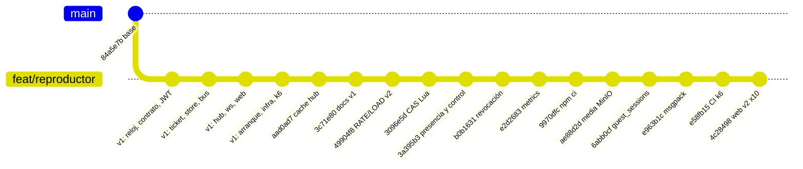

<details>
<summary>Commits de la v1</summary>

| Commit | Alcance | Contenido |
| :--- | :--- | :--- |
| `3c0c542` | sync-core | `internal/master` (ancla, `PositionAt`, `Apply`) e `internal/drift` (EWMA de RTT, umbrales). |
| `0625aba` | sync-core | Contrato `syncevent.Event`, tipos, códigos de error, `Validate`/`ValidateInbound`, claves Redis. |
| `ebe9146` | sync-core | `internal/config` y `internal/auth` (HS256, roles). |
| `665942d` | identity-api | `generateSyncTicket` + `POST /rooms/:id/sync-ticket`. |
| `8d00d56` | sync-core | `internal/store`: estado, dedupe, presencia de hosts. |
| `e0160a7` | sync-core | `internal/bus` (Pub/Sub) e `internal/telemetry` (`XADD analytics:events`). |
| `e9cecd5` | sync-core | `internal/hub`: salas, comandos, heartbeat, drift y `HOST_STATUS`. |
| `87ff669` | sync-core | `internal/ws`: handshake JWT, lectora/escritora, códigos de cierre. |
| `a102af5` | web | `syncProtocol.ts`, `drift.ts`, `useSyncSocket`, `SyncedPlayer`, `WatchRoom`. |
| `524428b` | sync-core | `server.Run`: Redis, ensamblado y apagado ordenado. |
| `8334b7f` | sync-core | Dockerfile, `docker-compose.yml`, `.env.example`, caché de CI. |
| `1b43dc0` | sync-core | Protocolo en `AGENTS.md` y `loadtest/sync.js`. |
| `aad0ad7` | sync-core | Caché del estado por sala en el hub. |
| `3c71e80` | docs | Este documento (v1). |
</details>

| Commit (v2) | Alcance | Contenido |
| :--- | :--- | :--- |
| `49904f8` | sync-core | Contrato v2: tipos `RATE`, `LOAD`, `CONTROL`, `REVOKED`; campos `media_id`, `rtt_ms`, `can_control`, `holder`, `jti`. |
| `3096e5d` | sync-core | **perf**: compare-and-set con Lua y candado por sala (reemplaza `WATCH/MULTI`). |
| `3a395b3` | sync-core | Barrido de presencia, `HOST_STATUS` ante caída de réplica, delegación de control, latido único por réplica, RTT/drift en `HEARTBEAT`. |
| `b0b1631` | sync-core | Revocación: 401 en el handshake y cierre `4001` en vivo (luego el handshake pasó a upgrade + `4001`, ver §6.8). |
| `e2d2683` | sync-core | `GET /metrics` (paquete propio, sin dependencias). |
| `9970dfc` | identity-api | `vitest` y `@vitest/coverage-v8` alineados: `npm ci` sin flags. |
| `ae88d2d` | identity-api | `PUT /rooms/:id/media` y `GET /rooms/:id/playback` con URL firmada de MinIO. |
| `6abb0cf` | identity-api | `guest_sessions`, `GET /rooms/:id/guests`, `POST /rooms/:id/guests/:jti/revoke`. |
| `e963b1c` | sync-core | MessagePack opcional (subprotocolo `tint.sync.msgpack`). |
| `e58fb15` | ci | Job de humo k6 (50 VUs) y job de identity-api. |
| `4c28498` … `8c7406f` | web | 10 commits: protocolo v2, hook v2, MessagePack, `useRoomPlayback`, paneles del Host, semáforo y reconexión, toasts, reproductor de cine, integración en `WatchRoom`, `AGENTS.md`. |

---

## 2. Requisitos y mejoras cubiertas

| Requisito | Descripción | Implementación |
| :--- | :--- | :--- |
| **HU-SYNC-01** | Canal `/ws/sync?room_id=X` aislado, estado inmediato | `hub.Connect` encola `STATE` antes que cualquier otro mensaje. |
| **REQ-27 / HU-SYNC-02** | Comandos del Host a todos en < 100 ms | CAS en Redis + Pub/Sub. Medido: 1–4 ms entre réplicas. |
| **REQ-28 / HU-SYNC-03** | Drift > 500 ms, corrección suave y métrica | `internal/drift` (`rate` ±5 % o `seek`) y `drift_correction` a `analytics:events`. |
| **REQ-07** | La sala sobrevive 12 h sin Host | TTL de 12 h. Ahora también se avisa la caída de la réplica del Host. |
| **REQ-08 / SYNC-BE-05** | Escalado entre réplicas | Pub/Sub, presencia compartida y barrido determinista. |
| **SYNC-TEST-01** | 500 conexiones | `loadtest/sync.js`. Humo de 50 VUs en CI. Ver [§14](#14-verificación-y-resultados). |
| **Ley 1581** | Analítica sin PII | `drift_correction`, `playback_command` y `buffering` sin `sub`, `nick` ni token (solo `role`). `GET /guests` no expone `sub`. |

| Mejora (v2) | Dónde |
| :--- | :--- |
| F3 Vídeo de la sala con URL firmada | identity-api (`media`, `playback`) + web (`useRoomPlayback`, panel "Cambiar vídeo") |
| F4 `HOST_STATUS` ante caída de réplica | sync-core (barrido + script Lua de transiciones) |
| F5 Revocación de invitados | identity-api (`guest_sessions`, `revoke`) + sync-core (`4001` en el handshake y en vivo) + web (panel "Participantes", pantalla de retiro) |
| F6 Comandos `RATE` y `LOAD` | sync-core (`master`) + web (selector de velocidad, cambio de vídeo) |
| F7 Delegación de control | sync-core (`CONTROL`) + web (`canControl`, aviso de control temporal) |
| F8 Volumen y calidad del Host | sync-core (`VOLUME`, `QUALITY`; ver [§6.9](#69-volumen-y-calidad-del-host-f8)). La web aún no los emite ni los aplica. |
| UX 1–6 | web (`SyncStatus`, `SyncToasts`, `SeekBar`, `usePlayerShortcuts`, reconexión, fundido) + `rtt_ms`/`drift_ms` en `HEARTBEAT` |
| O1 k6 en CI | `.github/workflows/ci-pipeline.yml` (`sync-load-smoke`) |
| O2 Bytes compartidos en broadcasts | Ya existía. Con MessagePack, cada broadcast se transcodifica una sola vez por sala. |
| O3 Un temporizador por réplica | `hub.Run` (`beatAll`) |
| O4 Escritura atómica más rápida | `store.Apply` (CAS Lua) |
| O5 Métricas | `internal/metrics` + `GET /metrics` |
| O6 MessagePack | `internal/codec` + `syncCodec.ts` |
| O7 `npm ci` de identity-api | Versiones alineadas + job de CI |

---

## 3. Vista general

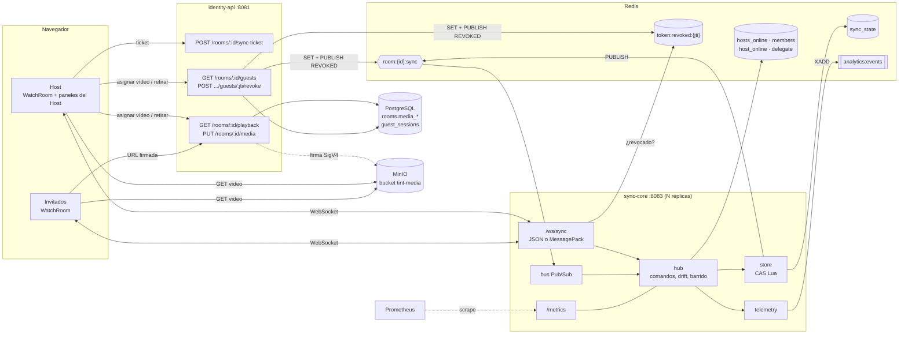

**Idea central:** sync-core no guarda "el segundo actual" ni usa temporizadores por sala. Guarda un **ancla** (posición, instante del servidor, velocidad y vídeo) y cualquiera puede calcular la posición en cualquier momento. Cada comando es una escritura atómica que además publica el cambio para todas las réplicas.

---

## 4. Mapa de cambios por dominio

```mermaid
flowchart TB
    classDef v1 fill:#1f3a5f,stroke:#6ea8fe,color:#fff
    classDef v2 fill:#0f5132,stroke:#75b798,color:#fff
    classDef mod fill:#664d03,stroke:#ffda6a,color:#fff

    subgraph SC["services/sync-core"]
        direction TB
        a1["master · drift · auth · bus · telemetry"]:::v1
        a2["syncevent<br/>contrato v2"]:::mod
        a3["store<br/>CAS Lua, presence.go"]:::mod
        a4["hub<br/>Run, barrido, delegación, métricas"]:::mod
        a5["ws<br/>subprotocolo, revocación, 4001"]:::mod
        a6["codec"]:::v2
        a7["metrics"]:::v2
        a8["server<br/>/metrics"]:::mod
        a9["config<br/>CONTROL_HANDOFF_AFTER"]:::mod
    end

    subgraph ID["services/identity-api"]
        b1["sync-ticket"]:::v1
        b2["media.signer<br/>@aws-sdk/s3"]:::v2
        b3["revocation.ts<br/>ioredis"]:::v2
        b4["guestSessions.repo"]:::v2
        b5["guestAuth middleware"]:::v2
        b6["migraciones 0001 y 0002"]:::v2
    end

    subgraph WEB["apps/web"]
        c1["useSyncSocket v2"]:::mod
        c2["syncCodec · syncQuality"]:::v2
        c3["useRoomPlayback · useSyncToasts<br/>usePlayerShortcuts"]:::v2
        c4["SeekBar · SyncStatus · SyncToasts"]:::v2
        c5["ChangeVideoPanel · ParticipantsPanel"]:::v2
        c6["SyncedPlayer · WatchRoom"]:::mod
    end

    subgraph INF["CI"]
        d1["job identity-api"]:::v2
        d2["job k6 50 VUs"]:::v2
    end

    b3 -- "token:revoked + REVOKED" --> a5
    b2 -- "mediaId" --> c3
    c1 -- "protocolo v2" --> a5
    c5 -- "PUT media / revoke" --> b2 & b3
    d2 --> SC
```

🟦 v1 sin cambios · 🟩 nuevo en v2 · 🟨 modificado en v2

---

## 5. El Reloj Maestro

| Campo | Significado |
| :--- | :--- |
| `status` | `playing` o `paused` |
| `position_ms` | Posición del vídeo **en el instante del ancla** |
| `updated_at_ms` | Instante del ancla, reloj del **servidor** (unix ms) |
| `rate` | Velocidad, entre 0.25 y 4 |
| `version` | Contador monotónico: orden total de comandos |
| `host_id` | `sub` del último Host conectado |
| `media_id` | Vídeo actual de la sala (v2) |
| `volume` | Volumen de la sala, entre 0 y 1 (F8; por defecto `1`) |
| `quality` | Calidad: `auto`, `source`, `720p` o `360p` (F8; por defecto `auto`) |

```text
PositionAt(t) = position_ms + (t − updated_at_ms) × rate   si playing
              = position_ms                                 si paused
```

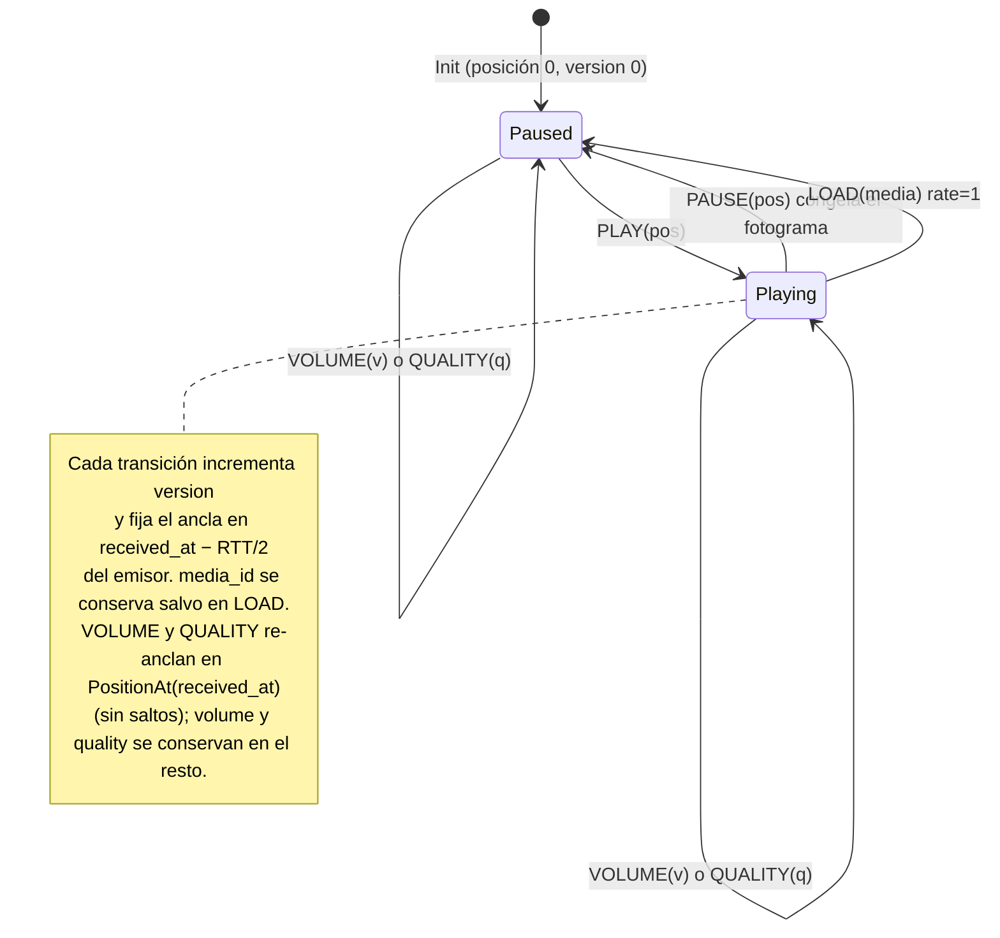

`master.Apply` es una función pura y es **la única** que calcula el siguiente estado. Redis solo lo persiste.

---

## 6. Flujos principales

### 6.1 Conexión (handshake)

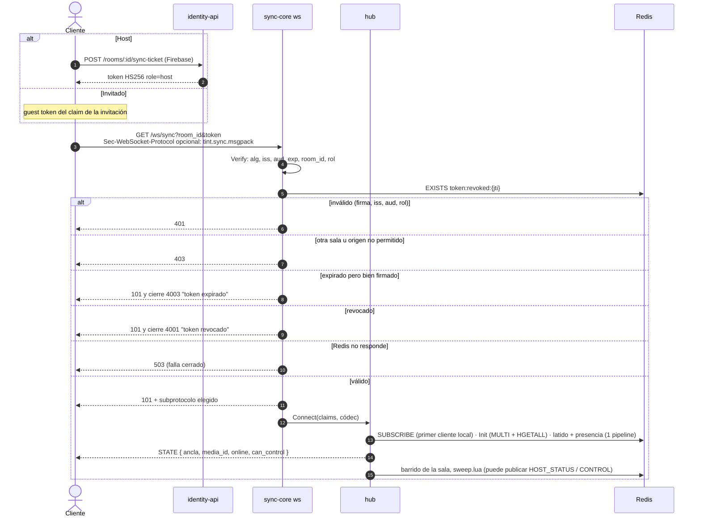

El `STATE` siempre se encola **antes** del barrido: así ningún `HOST_STATUS` o `CONTROL` se le adelanta (HU-SYNC-01).

### 6.2 Comando entre réplicas (compare-and-set)

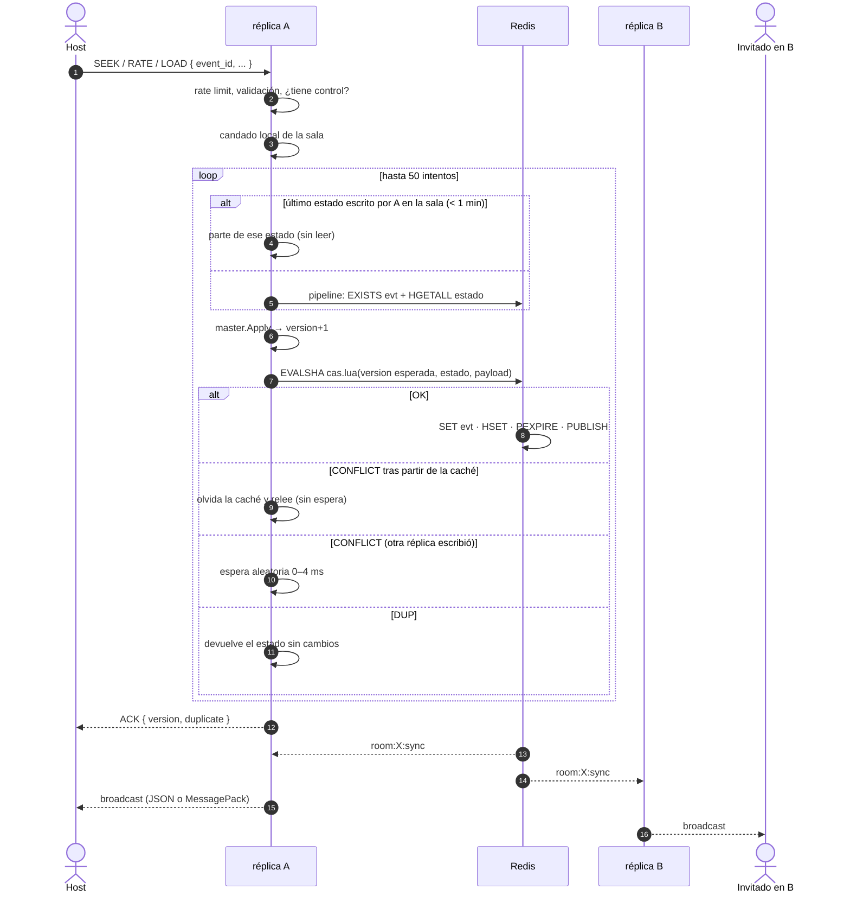

- Dentro de una réplica, el candado por sala elimina los conflictos. Entre réplicas, el script solo escribe si la `version` no cambió.
- Un comando tras otro de la misma réplica cuesta **una** ida y vuelta: el store recuerda (por franja del candado) el último estado que escribió y va directo al CAS. `version` no se repite mientras la clave viva, así que partir de ahí es tan seguro como leer; si otra réplica escribió, el CAS responde `CONFLICT` y se relee. El CAS no reescribe `host_id` (solo lo fija `Init`).
- La réplica emisora no difunde localmente: todo pasa por Pub/Sub.
- Los clientes filtran por `version`, porque el orden entre `ACK` y broadcast no está garantizado.

### 6.3 Latido, RTT y drift

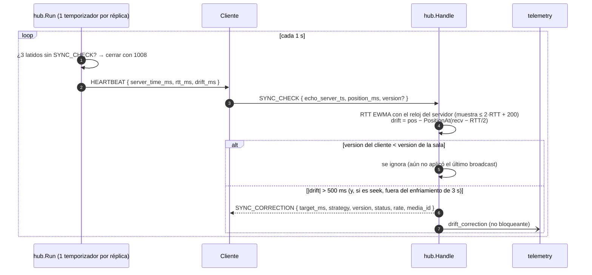

`SYNC_CORRECTION` incluye, además de `target_ms`, `strategy`, `drift_ms` y `version`, los campos opcionales `status`, `rate` (velocidad de la sala) y `media_id` del estado en esa `version`. Un cliente que perdió un broadcast (p. ej. por una reconexión del Pub/Sub) puede usarlos para reconciliar estado y vídeo; los clientes que no los conocen los ignoran. La web los aplica (ver §10, "Correcciones").

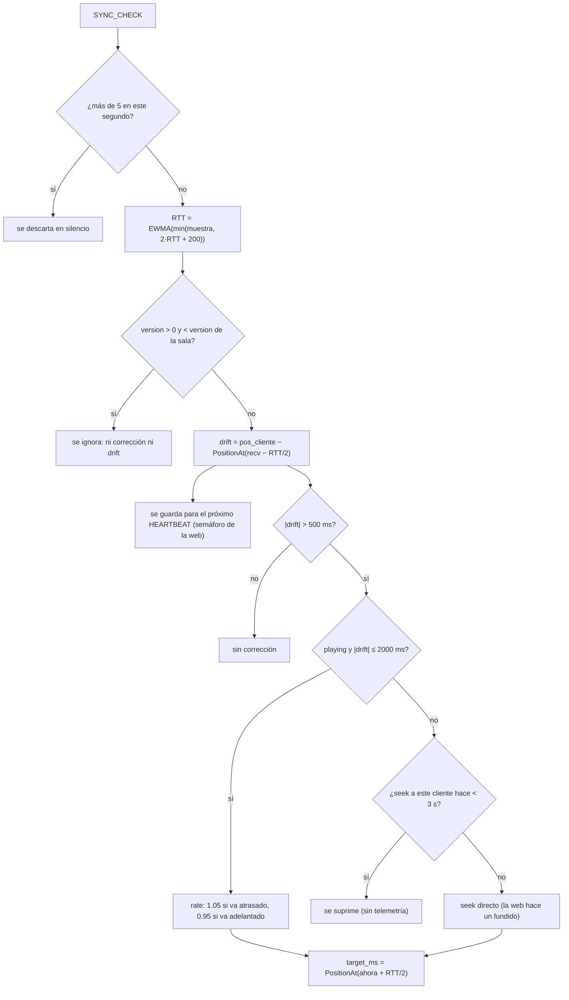

El `SYNC_CHECK` **no** toca Redis: el estado sale de la caché por sala y la presencia se renueva en el barrido.

**Protecciones contra tormentas de seek** (bug hunting de tirones, `fix/sync-core-correcciones-drift`):

| Medida | Por qué |
| :--- | :--- |
| **Recorte del RTT:** tras la primera muestra se usa `min(muestra, 2·RTT_previo + 200)` antes de la EWMA. | Un `SYNC_CHECK` retrasado (pestaña en segundo plano, GC, cola tras un stall) inflaba el RTT a ~1 s con una sola muestra y `target_ms` quedaba adelantado varios latidos. |
| **Enfriamiento de seek:** tras enviar un `seek` a un cliente no se le envía otro durante 3 s (`drift.SeekCooldownMs`); `rate` sigue permitido. El seek suprimido no emite `drift_correction`. | Un cliente en buffering reporta una posición congelada: cada latido producía otro seek, que volvía a provocar el stall (bucle seek→stall→seek). |
| **`version` opcional en `SYNC_CHECK`:** si es > 0 y menor que la `version` del estado usado, el servidor no corrige ni cuenta drift. Sin el campo (o `0`) el comportamiento no cambia. | Tras un `SEEK`/`LOAD` del host, el `SYNC_CHECK` enviado antes de aplicar el broadcast producía un segundo seek duplicado. **La web debe enviar la última `version` aplicada** (PR aparte en `apps/web`). |
| **Límite propio de `SYNC_CHECK`:** 5/s por conexión, fuera del límite general de 20 msg/s (el exceso se descarta en silencio). | Un host que hacía scrubbing al límite de comandos veía rechazados sus `SYNC_CHECK` y acababa cerrado por stale (`1008`). |
| **`STATE` sellado al encolarlo:** `server_time_ms` se toma justo antes de enviarlo, no al inicio de `Connect`. | El cliente proyecta la posición desde `server_time_ms`; con el sello viejo arrancaba atrasado lo que tardaban las idas y vueltas a Redis. |

### 6.4 Presencia y caída de la réplica del Host (F4)

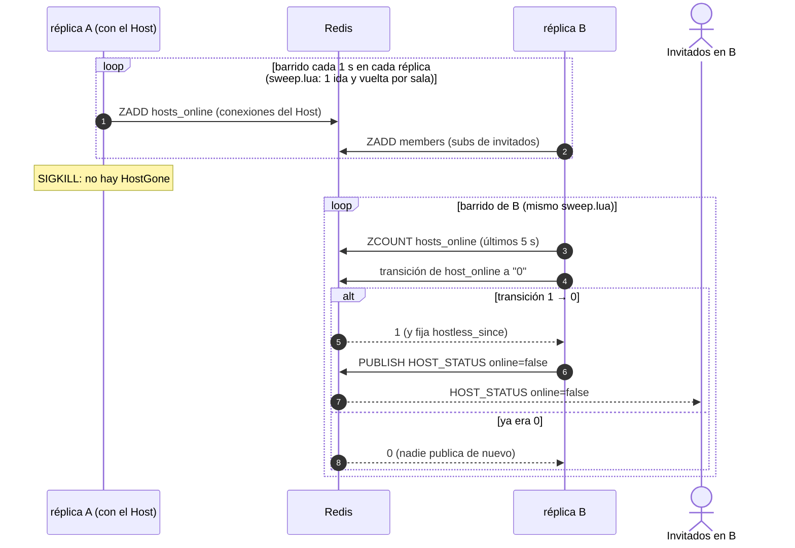

El script guarda el último estado publicado, así que varias réplicas pueden evaluar la misma sala sin publicar duplicados. Una sala a la que nunca entró el Host no "pierde" al Host.

### 6.5 Delegación de control (F7)

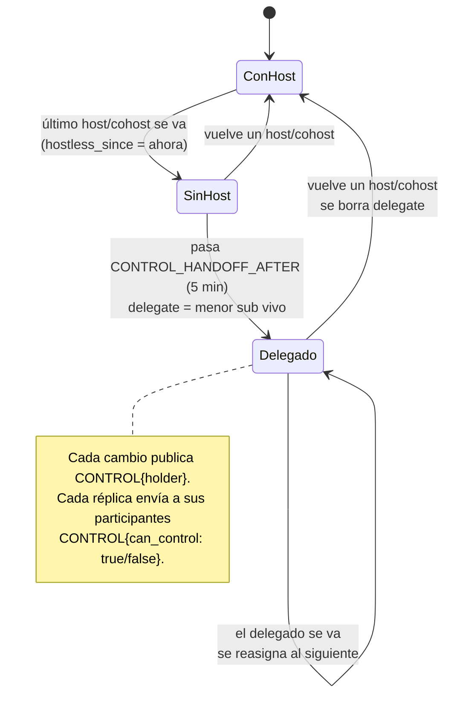

La elección es **determinista** (el `sub` menor entre los participantes vivos), así que todas las réplicas llegan al mismo delegado. `SET … GET` en Redis evita publicar dos veces el mismo cambio. El delegado puede usar `PLAY`/`PAUSE`/`SEEK`/`RATE`/`LOAD`/`VOLUME`/`QUALITY`. En la web, cambiar de vídeo requiere además el token Firebase del dueño.

### 6.6 Retirar a un invitado (F5)

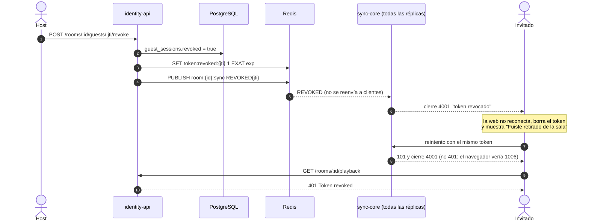

Un token revocado o expirado pero bien firmado **hace upgrade y se cierra** con `4001`/`4003` (tras la comprobación de origen): si el handshake respondiera 401, el navegador solo vería un cierre `1006` y la web reintentaría para siempre. Un token de otra sala o con firma inválida se sigue rechazando antes del upgrade (no se filtra información). `4003` es nuevo: la web debe tratarlo como terminal y pedir otro token (pendiente en `useSyncSocket.ts`).

`DELETE /rooms/:id` aplica esta misma secuencia a **todas** las sesiones de invitado activas de la sala (no revocadas y no vencidas), así que borrar una sala corta a los invitados conectados. `guest_sessions.revoked` se marca después de Redis: si Redis falla, la respuesta es 503 (la sala ya quedó borrada) y repetir el `DELETE` vuelve a publicar los `REVOKED` pendientes (responde 410 cuando termina).

#### Retirar vs. bloquear

| | Retirar (`POST /rooms/:id/guests/:jti/revoke`) | Bloquear (`POST /rooms/:id/bans { jti } \| { sub }`) |
| :--- | :--- | :--- |
| Sesión actual | Revoca ese `jti` (cierre `4001`) | Revoca **todas** las sesiones vigentes del invitado (`sub`) en la sala (cierre `4001`) |
| ¿Puede volver con el link? | Sí, con un claim nuevo | No desde el mismo navegador: el claim con su `deviceId` responde **403 `{ error: "BANNED" }`** |
| Persistencia | `guest_sessions.revoked` | `guest_sessions.revoked` + fila en `room_bans` (`device_id`, `sub`, `nick`) |
| Deshacer | — | `DELETE /rooms/:id/bans/:banId` (lista en `GET /rooms/:id/bans`) |
| Si Redis falla | 500 | **503**; el ban ya quedó guardado y repetir el `POST` (idempotente) termina de revocar |

sync-core y social-core no cambian: reciben el mismo `REVOKED{jti}` por cada sesión y cierran con `4001`. `{ sub }` sirve para bloquear desde el chat del Canal Social (donde la web conoce el `user_id` del invitado); `{ jti }`, desde el panel de invitados.

> ⚠️ El bloqueo es **por navegador**, no por persona: los invitados son anónimos y el `deviceId` es un UUID que la web guarda en `localStorage`. Borrar los datos del navegador, una ventana privada u otro dispositivo lo evaden, y las sesiones de clientes viejos sin `deviceId` solo quedan registradas por `sub` (no impiden volver a entrar). Detalle en [usuarios-e-identidad §6.6](usuarios-e-identidad.md#66-bloquear-a-un-invitado-por-dispositivo).

### 6.7 Subida y cambio de vídeo

El archivo **nunca pasa por identity-api**: el navegador lo sube directo a MinIO con una URL PUT firmada, y lo reproduce con una URL GET firmada.

```mermaid
sequenceDiagram
    autonumber
    actor Host
    participant ID as identity-api
    participant PG as PostgreSQL
    participant MI as MinIO
    participant R as Redis
    participant MW as media-worker
    participant SC as sync-core
    actor Inv as Invitados

    Host->>ID: POST /rooms/:id/media/uploads { filename, contentType, sizeBytes }
    ID->>PG: INSERT videos (pending)
    ID-->>Host: { videoId, uploadUrl, headers }
    Host->>MI: PUT incoming/{videoId}/original.mp4 (staging, progreso en la UI)
    Host->>ID: POST /rooms/:id/media/uploads/:videoId/complete
    ID->>MI: HEAD (409 si no llegó, 413 y DELETE si supera sizeBytes o MAX_UPLOAD_BYTES)
    ID->>PG: UPDATE videos SET status = processing WHERE status = pending
    ID->>R: XADD media:uploads video_id
    ID->>PG: rooms.media_id = videoId
    ID-->>Host: { mediaId }
    Host->>SC: LOAD { media_id, position_ms: 0 }
    SC-->>Inv: LOAD (pausa, rate 1, media_id)
    Inv->>ID: GET /rooms/:id/playback (guest token)
    ID-->>Inv: { url firmada, status, ambilightUrl }
    Inv->>MI: GET original (incoming/)
    R-->>MW: XREADGROUP media-workers
    MW->>MI: descarga incoming/{videoId}/original.mp4
    MW->>MW: ffprobe + normalizar (remux +faststart si ya es MP4 H.264/AAC ≤ 12 Mbps;<br/>si no, re-codificar con keyframe cada 2 s y tope de bitrate) + Ambilight
    MW->>MI: PUT {videoId}/source.mp4 (video/mp4) + {videoId}/ambilight.json
    MW->>PG: ready, duration_ms, storage_key = {videoId}/source.mp4
    MW->>R: XACK
    Note over Inv: la web consulta playback cada ~5 s mientras status es<br/>pending/processing. Al quedar ready la URL ya apunta a la versión publicada
```

| Paso | Endpoint / evento | Errores |
| :--- | :--- | :--- |
| Reservar | `POST /rooms/:id/media/uploads` | 400 (no es `video/*`), 413 (> `MAX_UPLOAD_BYTES`, 2 GiB), 403, 410 |
| Subir | `PUT uploadUrl` a MinIO (Content-Type firmado, 15 min) | CORS según `MINIO_CORS_ALLOW_ORIGIN` |
| Confirmar | `POST /rooms/:id/media/uploads/:videoId/complete` | 409 `Upload missing`, 413 si el objeto real supera el `sizeBytes` declarado o `MAX_UPLOAD_BYTES` (se borra del bucket y el vídeo sigue en `pending`), 503 si Redis falla (el vídeo vuelve a `pending` y se puede reintentar), 404. **Idempotente:** solo la transición `pending → processing` encola y asigna; si el vídeo ya no está en `pending` responde 200 con el estado actual sin re-encolar. |
| Procesar | `media:uploads` → media-worker (`python -m media_worker`, servicio de docker compose) | Si es válido lo normaliza (nunca publica el original: remux `-c copy` con `+faststart` si ya es MP4 H.264 + AAC de ≤ 12 Mbps, si no re-codificación H.264 con keyframe cada 2 s y tope VBV), publica `{videoId}/source.mp4` + `ambilight.json` (`Content-Type: video/mp4`, `Cache-Control: public, max-age=86400`) y actualiza `storage_key`; después genera las calidades `{videoId}/720p.mp4` y `{videoId}/360p.mp4` menores que el original y escribe las publicadas en `videos.renditions` (una calidad que falle se omite sin marcar `failed`). Si ffprobe o el Ambilight fallan queda `failed` y **no se publica nada**. Un fallo de SQL/S3 no confirma el evento: se reintenta cada 5 s |
| Reproducir | `GET /rooms/:id/playback` firma `videos.storage_key` (el original mientras se procesa, la versión publicada al quedar `ready`) y devuelve `qualities`: `Original` (= `url`) y, si está `ready`, `720p`/`360p` según `videos.renditions` (`{id}/{h}p.mp4`) | 401 si el token fue revocado, 410 si la sala se borró. Un vídeo `failed` responde `url: null` y `qualities: []` |

**Refresco de la URL en la web:** ~1 min antes de `expiresAt` la web pide `GET /playback` otra vez, pero si es el mismo vídeo **no** cambia el `src` del `<video>` (eso lo recargaba y dejaba un fotograma negro cada hora): guarda las URLs nuevas aparte —también las que aparecen al quedar `ready`— y las adopta solo si el `<video>` falla (`MEDIA_ERR_NETWORK`/`MEDIA_ERR_SRC_NOT_SUPPORTED`, p. ej. URL caducada o staging ya borrado; si no tiene URLs guardadas pide unas nuevas, como mucho cada 30 s) o cuando el `src` cambia igualmente (otra calidad u otro vídeo). Al cargar el `src` nuevo re-aplica la posición y el play/pausa del estado maestro.

Sigue existiendo `PUT /rooms/:id/media { mediaKey }`, para asignar un objeto que ya está en el bucket (sin fila en `videos`, `status: null`).

#### Biblioteca y reuso por `videoId`

El host puede volver a poner en cualquiera de sus salas un vídeo que ya subió, sin escribir la clave del bucket:

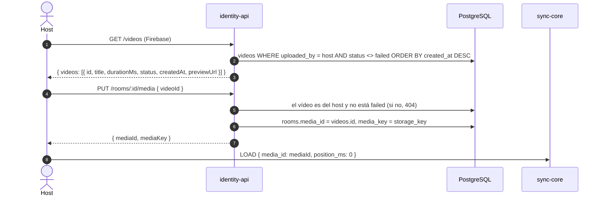

- **`title`:** el `filename` sin extensión, guardado al reservar la subida (`videos.title`, migración `0007`). Se renombra con `PATCH /videos/:id { title }` (1–255, solo quien lo subió; responde `{ video }` con la misma forma de la tarjeta). Los vídeos anteriores a `0007` tienen `title: null`.
- **`previewUrl`:** GET firmada (`PLAYBACK_URL_TTL_SECONDS`) para mostrar un fotograma en la tarjeta: `{id}/360p.mp4` si el vídeo está `ready` y `360` está en `renditions`; si no, `storage_key` (el original de `incoming/` mientras se procesa).
- **Reuso:** como `media_id = videos.id` (no un uuid nuevo como con `mediaKey`), `GET /rooms/:id/playback` sigue resolviendo `status`, `qualities` y `ambilightUrl` del vídeo. Solo se reusan vídeos confirmados (`processing`/`ready`): uno `pending` (reservado sin confirmar, el objeto puede no existir), `failed`, inexistente o de otro host responde 404. La biblioteca lista los mismos estados.

**Staging `incoming/`.** El original del navegador nunca va a la clave publicada: el media-worker solo publica vídeos que validó (regla de su dominio). `minio-init` importa una regla de ciclo de vida que borra `incoming/` a los 2 días, así quien ya reproducía el original no se corta al publicarse la versión procesada.

### 6.8 Ciclo de vida de una conexión

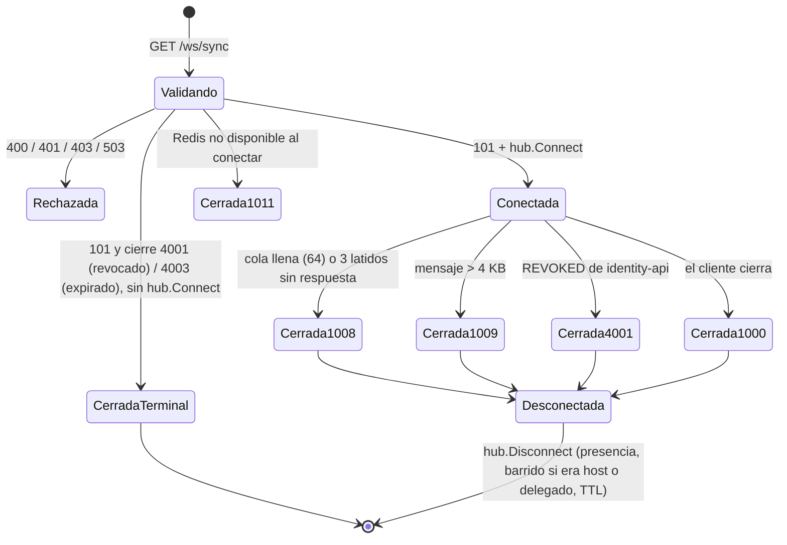

### 6.9 Volumen y calidad del Host (F8)

El Host (o un cohost, o el participante con control delegado) fija el volumen y la calidad de reproducción de toda la sala. Siguen el mismo camino que `RATE`/`LOAD`: CAS en Redis, broadcast por Pub/Sub a todas las réplicas y `ACK` al emisor.

| Comando | Campo | Valores válidos | Error |
| :--- | :--- | :--- | :--- |
| `VOLUME` | `volume` (número) | [0, 1], ambos incluidos; `0` = silencio | ausente, `NaN` o fuera de rango → `ERROR{INVALID}` |
| `QUALITY` | `quality` (string) | `auto`, `source`, `720p`, `360p` | cualquier otro valor → `ERROR{INVALID}` |

Un `participant` sin control recibe `ERROR{FORBIDDEN}` y el estado no cambia.

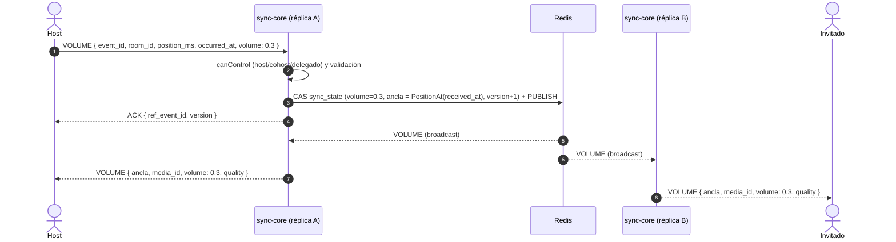

- **Sin saltos:** a diferencia de `SEEK`/`RATE`, `VOLUME` y `QUALITY` no usan la `position_ms` del emisor ni el desplazamiento por RTT: el ancla se fija en la posición maestra del instante de recepción y se conservan `status` y `rate`. Así un Host con drift no mueve la reproducción de los demás.
- **Siempre presentes:** `volume` y `quality` viajan en todo broadcast de comando, en `STATE` y en `SYNC_CORRECTION`. `volume` se envía explícito aunque sea `0` (en Go es un puntero; en MessagePack se omite solo si falta).
- **Compatibilidad:** los hashes `room:{id}:sync_state` anteriores sin `volume`/`quality` se leen como `1` y `auto` (`store.Init` los agrega con `HSETNX`), y un broadcast de una réplica anterior sin esos campos se cachea con los mismos valores por defecto.
- **Web:** pendiente. El cliente debe aplicar `volume`/`quality` de `STATE`, broadcasts y `SYNC_CORRECTION`, y ofrecer los controles solo a quien tenga `can_control`.

### 6.10 Telemetría de reproducción y `BUFFERING`

sync-core publica tres tipos en `analytics:events` ([contrato](contrato-eventos-analitica.md#sync-core)), todos con `source=sync-core`, `role` y **sin** `sub` ni `nick`, por el mismo canal con buffer de `internal/telemetry` (si se llena se descartan y se cuentan en `sync_telemetry_dropped_total`):

| `type` | Cuándo | Campos propios |
| :--- | :--- | :--- |
| `playback_command` | Comando aplicado (no duplicado ni rechazado), incluidos `VOLUME` y `QUALITY`, con el `event_id` del comando | `command`, `position_ms` (ancla resultante) |
| `drift_correction` | Cada `SYNC_CORRECTION` (antes `sync_drift`) | `drift_ms`, `position_ms` (= `target_ms`), `rtt_ms`, `strategy` |
| `buffering` | Mensaje `BUFFERING` aceptado, con su `event_id` | `duration_ms`, `position_ms` |

`BUFFERING` es el único mensaje cliente → servidor que no es comando ni latido. La web lo envía al terminar un stall del `<video>` (`waiting` → `playing`) si duró al menos 100 ms:

```json
{ "event_id": "<uuid>", "type": "BUFFERING", "room_id": "<uuid>", "position_ms": 12345, "duration_ms": 850, "occurred_at": "<RFC3339>" }
```

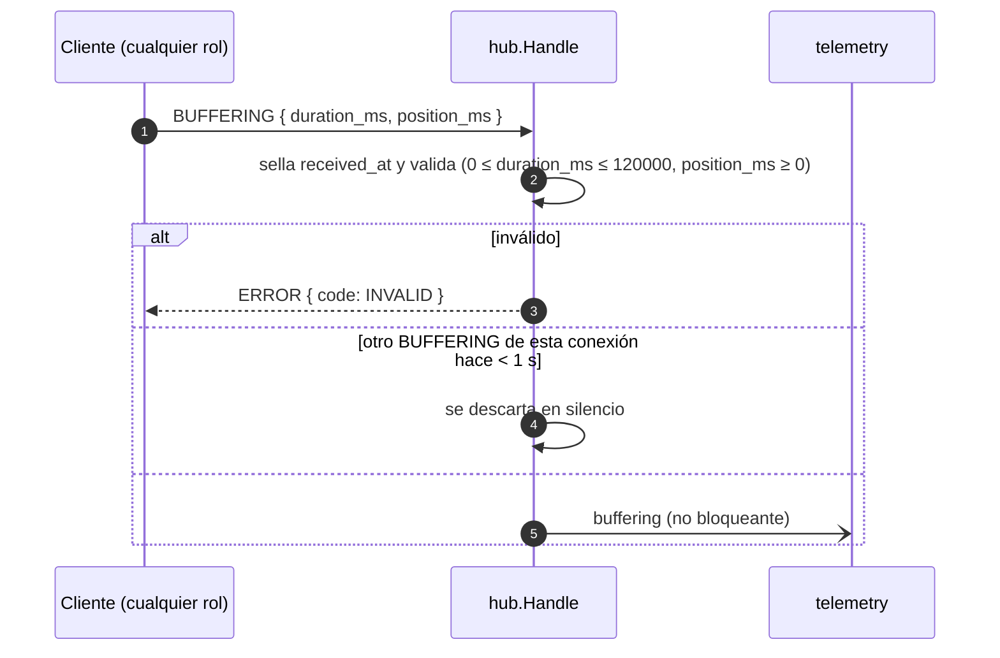

No hay `ACK`, no hay broadcast y no se toca Redis en el camino del mensaje. Con MessagePack viajan las mismas claves (`duration_ms`).

---

## 7. Modelo de datos en Redis

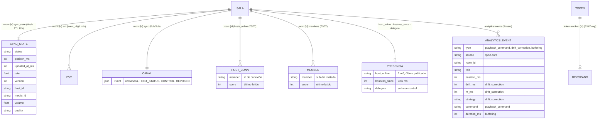

| Clave | Escrita por | Vida |
| :--- | :--- | :--- |
| `room:{id}:sync_state` | `store.Init`/`Apply`/`Touch`; `Sweep` renueva el TTL en el barrido | 12 h desde la última actividad o desde que no quedan clientes conectados |
| `room:{id}:evt:{event_id}` | `store.Apply` | 1 min |
| `room:{id}:hosts_online`, `room:{id}:members` | `Sweep` en el barrido; `BeatPresence` al conectar; `HostGone`/`MemberGone` | 12 h; cuentan 5 s desde el último latido |
| `room:{id}:host_online`, `room:{id}:hostless_since` | `Sweep` (Lua, en el barrido y al conectar/desconectar) | 12 h |
| `room:{id}:delegate` | `SwapDelegate` | 12 h |
| `token:revoked:{jti}` | identity-api | hasta la expiración del token |
| `analytics:events` | `telemetry.Run` | `MAXLEN ~100000` |

En PostgreSQL (identity-api): `rooms.media_id`/`rooms.media_key` y la tabla `guest_sessions` (`jti`, `room_id`, `sub`, `nick`, `joined_at`, `expires_at`, `revoked`).

---

## 8. Arquitectura interna de sync-core

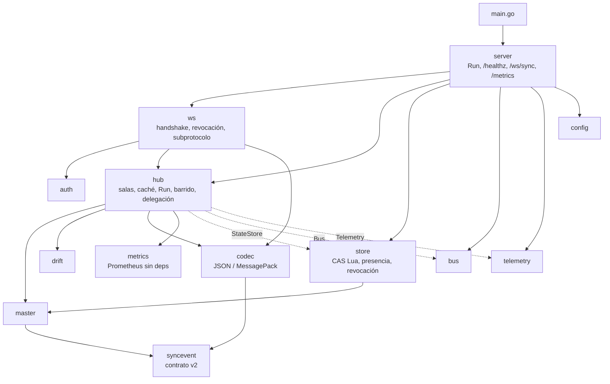

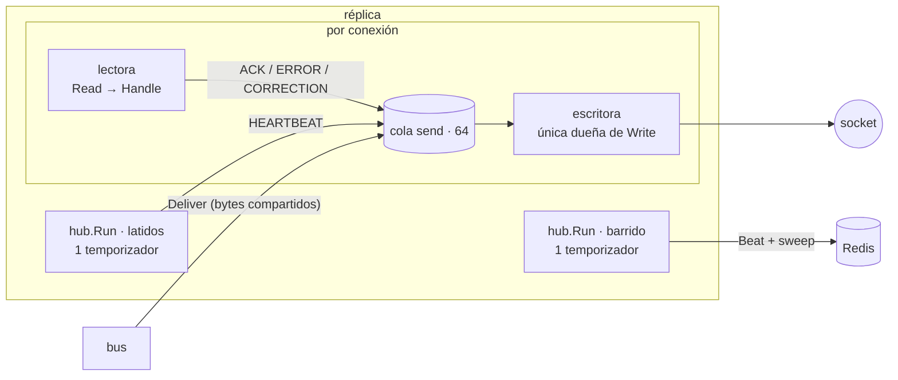

- **Antes (v1):** cada conexión tenía su propio `time.Ticker` en la escritora.
- **Ahora (v2):** un único recorrido por réplica encola los latidos y cierra a los clientes sin respuesta, y la escritora solo drena la cola.
- La **caché por sala** (v1) sigue evitando un `HGETALL` por cada `SYNC_CHECK`. En v2 también guarda `media_id` y el delegado vigente.

---

## 9. identity-api: vídeo de la sala e invitados

| Método y ruta | Autorización | Respuesta |
| :--- | :--- | :--- |
| `POST /rooms/:id/sync-ticket` | Host dueño (Firebase) | `{ token, expiresAt }` (HS256, `role: host`, 10 min) |
| `POST /rooms/:id/media/uploads` | Host dueño | `{ videoId, uploadUrl, storageKey, expiresAt, headers }`: reserva el vídeo y firma el PUT a MinIO |
| `POST /rooms/:id/media/uploads/:videoId/complete` | Host dueño | `{ mediaId, mediaKey, status }`: HEAD del objeto (tamaño real), `pending → processing`, `XADD media:uploads` y asignación a la sala. Idempotente |
| `PUT /rooms/:id/media` | Host dueño | `{ mediaId, mediaKey }`. Con `{ mediaKey }` asigna un objeto que ya está en el bucket (nuevo `mediaId` en cada llamada); con `{ videoId }` reusa un vídeo de su biblioteca (`mediaId = videoId`, `mediaKey = storage_key`; 404 si no es suyo o no está `processing`/`ready`) |
| `GET /videos` | Host (Firebase) | `{ videos: [{ id, title, durationMs, status, createdAt, previewUrl }] }`: sus vídeos confirmados (`processing`/`ready`), recientes primero |
| `PATCH /videos/:id` | Host que lo subió | `{ title }` (1–255) → `{ video }` (misma forma); 404 si no es suyo |
| `GET /rooms/:id/playback` | Host dueño **o** guest token de la sala no revocado | `{ mediaId, url, expiresAt, status, ambilightUrl, qualities }` (`null`s y `qualities: []` si no hay vídeo) |
| `GET /rooms/:id/guests` | Host dueño | `{ guests: [{ jti, nick, joinedAt, expiresAt, revoked }] }` (sin `sub`) |
| `POST /rooms/:id/guests/:jti/revoke` | Host dueño | `{ success: true }`, idempotente; 404 si el `jti` no es de la sala |
| `POST /rooms/:id/bans` | Host dueño | `{ jti }` o `{ sub }` → `{ ban: { id, nick, createdAt } }`; bloquea el dispositivo y revoca todas las sesiones del invitado. Idempotente; 404 si no tiene sesiones en la sala; 503 si Redis falla |
| `GET /rooms/:id/bans` | Host dueño | `{ bans: [{ id, nick, createdAt }] }` (sin `device_id` ni `sub`), recientes primero |
| `DELETE /rooms/:id/bans/:banId` | Host dueño | `{ success: true }`; 404 si no existe en la sala |
| `POST /invitations/claim` | — | Registra la sesión en `guest_sessions` (con `device_id`); `nick` ≤ 64 caracteres; `deviceId` opcional (UUID): **403 `{ error: "BANNED" }`** si ese dispositivo está bloqueado en la sala |

- **Firmado:** se usa `@aws-sdk/client-s3` + `@aws-sdk/s3-request-presigner`, con `forcePathStyle` para MinIO. La firma SigV4 se calcula en local, sin llamar a MinIO.
- **Host de la URL firmada:** se firma contra `MINIO_PUBLIC_ENDPOINT`, el host que ve el navegador.
- **Revocación:** se comprueban tanto la base de datos como Redis. Si alguno falla, responde 503 (falla cerrado).

---

## 10. Cliente web

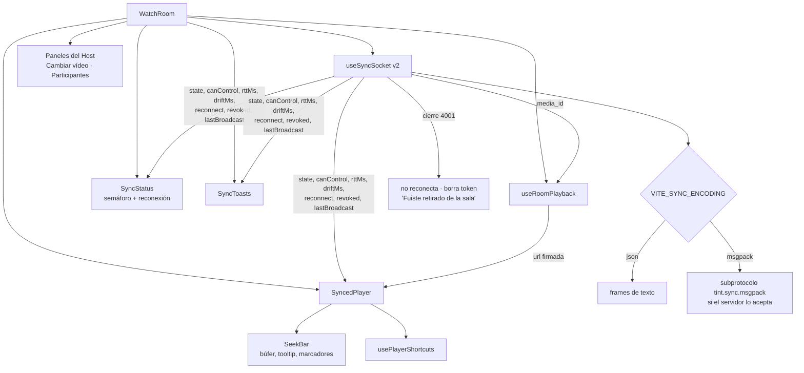

| Elemento | Comportamiento |
| :--- | :--- |
| Semáforo | 🟢 RTT < 150 ms y \|drift\| < 200 ms · 🟡 RTT < 400 ms y \|drift\| ≤ 500 ms · 🔴 resto. Muestra los números en texto accesible. |
| Reconexión | "Reconectando… intento N · S s" con cuenta regresiva del backoff (500 ms → 10 s). |
| Avisos | "El host pausó en 12:34", "saltó a…", "cambió la velocidad a 1.5×", "cargó un nuevo vídeo". Máximo 3 a la vez, 3 s cada uno, `aria-live`. No se muestran los comandos propios. |
| Barra de cine | `role="slider"`: búfer, tiempo bajo el cursor, marcadores de los saltos del Host; flechas ±5 s y RePág/AvPág ±30 s. |
| Atajos | Espacio/K reproducir o pausar · ←/→ o J/L ±10 s · `[`/`]` velocidad · `?` ayuda. Llevan `aria-keyshortcuts` y se ignoran dentro de campos de texto. |
| Fundido | ~150–200 ms en correcciones por seek y en saltos de más de 2 s. Desactivado con `prefers-reduced-motion`. |
| Aplicar estado | Cada `STATE`/broadcast aplica siempre la velocidad y el play/pausa, pero solo hace seek si la deriva supera 250 ms reproduciendo (50 ms en pausa): un `VOLUME`/`QUALITY`/`RATE` no hace saltar a nadie. En la misma conexión, un `STATE` con `version` menor a la aplicada se descarta; el primero de cada conexión siempre aplica (la sala pudo reiniciarse tras el TTL). |
| `SYNC_CHECK` | Lleva la `version` del estado aplicado. Tras un `LOAD`, hasta que llega la URL nueva, informa la posición esperada del estado maestro en lugar de la del vídeo anterior. |
| Correcciones | `rate`: velocidad de la sala × 1.05 (atrasado) o × 0.95 (adelantado) y vuelta a la velocidad de la sala. `seek`: se omite si el vídeo está en buffering (reproduce con `readyState` < `HAVE_FUTURE_DATA`), si el autoplay está bloqueado, si terminó y el objetivo está en o tras el final, o si ya está a < 250 ms del objetivo. Si la corrección trae `status` y `rate` (y `media_id`) distintos del estado aplicado, la web adopta ese estado (broadcast perdido). |
| Autoplay | Solo un `NotAllowedError` muestra "Unirse a la reproducción"; un `AbortError` (carrera PLAY → PAUSE, cambio de `src`) se ignora. |
| Calidad `auto` | 360p con 2g/3g o `saveData`; 720p con ancho < 640 px; si no, 720p salvo `navigator.connection.downlink` ≥ 10 Mbps (original). Sin Network Information API → 720p. Si no existe, el original. |
| Control | Los controles se habilitan según `canControl` del servidor. Un participante con control delegado ve "El host no está: tienes el control temporal". |

---

## 11. Seguridad y límites

| Aspecto | Medida |
| :--- | :--- |
| Autenticación | JWT HS256 de identity-api: algoritmo fijo, `iss`, `aud`, `exp`, `sub`, `room_id`. Se valida **antes** del upgrade. |
| Revocación | `token:revoked:{jti}` en el handshake (upgrade y cierre `4001`; 503 si Redis no responde) y `REVOKED` en vivo (cierre `4001`). Token expirado bien firmado: upgrade y cierre `4003`. |
| Autorización | `host`/`cohost` siempre; un participante solo si es el delegado vigente. El resto recibe `FORBIDDEN`. |
| Origen | `OriginPatterns` desde `ALLOWED_ORIGINS`. |
| Tamaño y frecuencia | 4 KB por mensaje (`1009`) y 20 mensajes/s (`RATE_LIMITED`); `SYNC_CHECK` no cuenta en ese límite y tiene el suyo de 5/s (el exceso se descarta en silencio). |
| Argumentos | `rate` ∈ [0.25, 4], `media_id` de 1 a 128 caracteres y `duration_ms` de `BUFFERING` en [0, 120000]; fuera de rango → `INVALID`. `BUFFERING`: máximo 1 por segundo y conexión (el exceso se descarta). |
| Vídeo | URL firmada con vida corta (`PLAYBACK_URL_TTL_SECONDS`); el bucket no es público. |
| Privacidad | `drift_correction`, `playback_command` y `buffering` sin PII (solo `role`); `/guests` no expone `sub`; `/metrics` sin identificadores de usuario y detrás del ingress. |

---

## 12. Observabilidad

`GET /metrics` (formato Prometheus) en cada réplica:

| Métrica | Tipo | Para qué |
| :--- | :--- | :--- |
| `sync_connections`, `sync_rooms` | gauge | Carga de la réplica |
| `sync_commands_total{result}` | counter | `ok`, `duplicate`, `forbidden`, `invalid`, `error` |
| `sync_command_apply_seconds` | histograma | Duración de la escritura atómica en Redis |
| `sync_broadcast_delivery_seconds` | histograma | Recepción del comando → entrega por Pub/Sub en esta réplica |
| `sync_store_conflicts_total` | counter | Reintentos por escrituras de otras réplicas |
| `sync_disconnects_total{reason}` | counter | `normal`, `stale`, `slow`, `revoked` |
| `sync_corrections_total{strategy}` | counter | `rate` / `seek` |
| `sync_messages_invalid_total`, `sync_messages_rate_limited_total` | counter | Clientes mal formados o abusivos |
| `sync_telemetry_dropped_total`, `sync_telemetry_failed_total` | counter | Salud del envío a `analytics:events` |

---

## 13. Configuración y ejecución local

```bash
cp .env.example .env                     # JWT_SECRET compartido por identity-api y sync-core
docker compose up -d --build             # postgres, redis, minio (+ bucket), identity-api :8081 (con sus migraciones), web :5173, social-core :8082 y sync-core :8083
# Desarrollo con recarga: detén el contenedor y usa `npm run dev` en services/identity-api o apps/web
```

Para probar el vídeo:
1. Como Host, en la sala usa **"Subir vídeo"** y elige un archivo; se sube directo a MinIO con barra de progreso.
2. Al terminar, todos los conectados reciben `LOAD` y lo reproducen desde MinIO.
3. El media-worker (servicio de `docker compose`) lo procesa: el vídeo pasa a `ready`, aparece "Ambilight listo" y la reproducción usa la versión publicada. Un archivo corrupto queda en `failed` con un aviso.

| Variable | Servicio | Por defecto |
| :--- | :--- | :--- |
| `JWT_SECRET`, `JWT_ISSUER`, `JWT_AUDIENCE` | sync-core, identity-api | `dev-secret-change-in-prod`, `tint-identity`, `tint:room` |
| `ALLOWED_ORIGINS` (`SYNC_ALLOWED_ORIGINS` en compose) | sync-core | `localhost:5173,127.0.0.1:5173` |
| `ROOM_TTL` / `CONTROL_HANDOFF_AFTER` | sync-core | `12h` / `5m` |
| `SYNC_TICKET_TTL_SECONDS` | identity-api | `600` |
| `MINIO_ENDPOINT` / `MINIO_PUBLIC_ENDPOINT` | identity-api | `http://localhost:9000` / igual a `MINIO_ENDPOINT` |
| `MINIO_ACCESS_KEY` / `MINIO_SECRET_KEY` / `MINIO_BUCKET` / `MINIO_REGION` | identity-api | `tintadmin` / `tintadmin123` / `tint-media` / `us-east-1` |
| `PLAYBACK_URL_TTL_SECONDS` | identity-api | `3600` |
| `UPLOAD_URL_TTL_SECONDS` / `MAX_UPLOAD_BYTES` | identity-api | `900` / `2147483648` (2 GiB) |
| `MINIO_CORS_ALLOW_ORIGIN` | docker compose (MinIO) | `http://localhost:5173` |
| `VITE_SYNC_WS_URL` | web | `ws://localhost:8083/ws/sync` |
| `VITE_SYNC_ENCODING` | web | `json` (`msgpack` opcional) |
| `VITE_DEMO_VIDEO_URL` | web | respaldo solo si la sala no tiene vídeo |

---

## 14. Verificación y resultados

| Suite | Resultado | Cobertura |
| :--- | :--- | :--- |
| sync-core (`gofmt`, `go vet`, `go test -race`) | ✅ todas pasan | **95,7 %** |
| identity-api (`npm ci`, `tsc`, Vitest) | ✅ 100 pruebas | **98,7 %** líneas · 91,7 % ramas |
| web (lint, `tsc`, Vitest, build) | ✅ 309 pruebas | **98,9 %** líneas · 95,2 % ramas |

**Benchmarks del store contra Redis 7 real** (`BENCH_REDIS_URL`):

| Escenario | `WATCH/MULTI` (v1) | CAS Lua (v2) |
| :--- | :--- | :--- |
| Un host, en serie | 0,66–1,42 ms/op · 105 allocs | **0,24–0,49 ms/op** · 78 allocs |
| 16 escritores en una réplica | 7,07 ms/op y **comandos perdidos** (se agotaban los 50 reintentos) | **0,27–0,32 ms/op**, sin pérdidas |
| Dos réplicas compitiendo | — | 0,34–0,79 ms/op, sin pérdidas |

**Ronda de optimización de caminos calientes** (2026-10, `go test -bench -benchmem -count 6` + `benchstat`, Ryzen 3 2200G con la máquina muy cargada; Redis 7 real en Docker con un Ping de 0,6–1,9 ms, por eso la métrica fiable para Redis es **rt/op**, idas y vueltas por operación, que cuenta un hook de go-redis):

| Camino | Antes | Después |
| :--- | :--- | :--- |
| `beatAll`, 500 clientes JSON (HEARTBEAT con plantilla por sala y tick) | 1424 µs · 361 KiB · 3008 allocs | **268 µs** · 158 KiB · 1012 allocs |
| `Handle` de `SYNC_CHECK` sin drift, JSON (sin timer de contexto si la caché vale) | 8,6 µs · 12 allocs | **7,6 µs** · 8 allocs |
| `store.Apply` en serie (parte del último estado propio) | 2 rt/op · 75 allocs | **1 rt/op** · 40 allocs |
| Barrido por sala, 1 host + 49 invitados (`sweep.lua`) | 3 rt/op · 6,4 ms · 182 allocs | **1 rt/op** · 2,5 ms · 81 allocs |
| Alta + baja de un invitado (`Connect`/`Disconnect`) | 8 rt/op | **5 rt/op** |

**Efecto de punta a punta (A/B con k6, 500 VUs, 30 s, misma máquina, corridas alternadas antes/después):** la latencia de retransmisión **no cambia de forma medible**. El p99 fue 30–40 ms antes y 42–85 ms después, dentro del ruido de k6 y del servidor en la misma máquina. La ronda reduce trabajo por réplica (CPU de latidos ~5×, idas y vueltas a Redis por comando y por barrido, asignaciones); es capacidad, no latencia para un usuario aislado. Al repetir la medición con la máquina descargada, **ambas versiones cumplen p99 < 100 ms con 500 VUs**: el fallo anterior (abajo) se debía a la carga de la máquina, no a sync-core.

Descartado por no mejorar: buffer prereservado para MessagePack (mismo tiempo, más asignaciones) y tocar el fan-out de `Deliver` (el costo es el envío por canal a cada cliente, inherente). El HEARTBEAT MessagePack sigue por el códec.

**MessagePack frente a JSON** (mensaje PLAY completo): 402 → 364 B (**−9,5 %**), ~5,6 → ~5,0 µs para codificar. La ganancia es pequeña porque el contrato exige claves y fechas de texto; por eso es opcional.

**Prueba de punta a punta v2** (dos réplicas reales y Redis; códec real de la web y funciones reales de revocación de identity-api):
- Subprotocolo MessagePack negociado; `STATE` decodificado por `syncCodec.ts` con `can_control`.
- `LOAD` y `RATE` cruzan réplicas en **1–4 ms**, con `media_id`.
- `HEARTBEAT` con `rtt_ms` y `drift_ms`.
- Revocación: el invitado se cierra con **4001** y la reconexión recibe **401** (medido antes de que el handshake pasara a upgrade + `4001`).
- Réplica del Host matada con `SIGKILL`: la otra publica `HOST_STATUS offline` en **~4,7 s** y delega el control. El delegado hace `SEEK` y al volver el Host lo pierde.

**Carga k6:**

| Escenario | Resultado |
| :--- | :--- |
| Humo de CI (50 VUs, 20 s) | ✅ todos los umbrales; p95 de retransmisión **11 ms** |
| 500 VUs, k6 y servidor en la misma máquina de 4 núcleos, máquina cargada | ✅ handshakes, drift, `FORBIDDEN` · ❌ latencia p99 < 100 ms (p95 entre 128 y 315 ms) |
| 500 VUs, misma máquina descargada (2026-10-11, antes y después de la ronda de optimización) | ✅ todos los umbrales; p99 30–85 ms |

Con las métricas nuevas, durante la corrida de 500 VUs:
- En el servidor, la escritura del comando y la entrega por Pub/Sub promediaron ~12 ms cada una, sin conflictos.
- En la corrida anterior con 500 clientes en Go, el p99 de punta a punta fue de 25 ms.

La cola larga aparece cuando la máquina está cargada (k6 y el servidor compiten por los mismos 4 núcleos); con la máquina descargada no aparece. El umbral **no se relajó**. La prueba representativa sigue siendo con k6 en otra máquina.

---

## 15. Decisiones de diseño

| Tema | Decisión | Motivo |
| :--- | :--- | :--- |
| Escritura atómica | CAS: lectura en pipeline (o el último estado propio) + Lua condicionado a `version` + candado por sala | `master.Apply` sigue siendo la única fuente de verdad (no se duplica en Lua); con `WATCH` se perdían comandos bajo contención. |
| Presencia | ZSET con score = último latido, renovado en lote en el barrido | Expira a las conexiones de réplicas caídas; `SYNC_CHECK` ya no escribe en Redis. |
| `HOST_STATUS` | Script que guarda el último valor publicado | Solo se publican transiciones, sin duplicados entre réplicas. |
| Delegado | Menor `sub` vivo | Determinista entre réplicas, sin coordinación extra. |
| Latidos | Un temporizador por réplica; JSON con plantilla por sala y tick | 500 conexiones = 1 timer en lugar de 500, y un `json.Marshal` por sala en lugar de uno por cliente (idéntico byte a byte). |
| Revocación | Marca en Redis + `REVOKED` por el canal de la sala | sync-core no depende de identity-api en tiempo real; falla cerrado. |
| Métricas | Paquete propio | Evita `client_golang` y sus dependencias transitivas para un conjunto fijo de métricas. |
| MessagePack | Opcional; el bus sigue en JSON | Ahorro medido de ~10 %; se transcodifica una vez por sala. |
| `STALE` | Cierre `1008`, no mensaje `ERROR` | Un cliente que no responde latidos no leería el mensaje. |

---

## 16. Limitaciones conocidas

- **Latencia k6 con 500 VUs:** cumple p99 < 100 ms en la misma máquina descargada; falta confirmarlo con k6 en otra máquina (ver §14).
- **Token expirado:** sync-core cierra con `4003`, pero la web aún no lo trata como terminal (solo se detiene ante `4001`) y seguirá reintentando hasta adoptarlo.
- **Cohost:** sync-core lo acepta, pero aún nadie emite tokens `role: cohost` y no hay UI para asignarlo.
- **Usuario sin token:** `WatchRoom` lo trata como Host y pide un ticket, que falla si no es el dueño.
- **Cambio de vídeo:** solo desde la UI del Host dueño, porque `PUT /media` exige Firebase. `PUT /media` tampoco comprueba que el objeto exista en MinIO.
- **Avisos:** dicen "El host…" aunque el comando lo haya enviado un participante con control delegado.
- **Producción:**
  - `/metrics` debe quedar detrás del ingress.
  - `guest_sessions.room_id` no tiene índice.
  - Las claves de Redis no usan *hash tags* (Redis Cluster requeriría ajustarlas).
- **`make test-all`:** se detiene en los servicios Python si el entorno no tiene `pytest`.
