# identity-api

Servicio de **identidad** de TINT (Node.js 22, TypeScript, Express 5, Drizzle ORM sobre PostgreSQL). Es la única puerta HTTP de la web para todo lo que no es tiempo real: quién es el Host, qué salas tiene, quién entra como invitado y qué vídeo se reproduce.

Este README explica **cómo funciona por dentro**. La referencia detallada (tabla completa de rutas, códigos de error y variables) está en [AGENTS.md](AGENTS.md); aquí se enlaza en vez de repetirla.

## Índice

1. [Propósito y responsabilidades](#1-propósito-y-responsabilidades)
2. [Arquitectura interna](#2-arquitectura-interna)
3. [Cómo funciona, paso a paso](#3-cómo-funciona-paso-a-paso)
4. [Estado y datos](#4-estado-y-datos)
5. [Configuración](#5-configuración)
6. [Ejecutar y probar](#6-ejecutar-y-probar)
7. [Observabilidad y errores](#7-observabilidad-y-errores)
8. [Decisiones de arquitectura](#8-decisiones-de-arquitectura)
9. [Enlaces](#9-enlaces)

---

## 1. Propósito y responsabilidades

| Hace | Dónde |
| :--- | :--- |
| Verifica el ID token de Firebase (RS256) del Host y crea o actualiza su fila en `users` con un *upsert* atómico | `middlewares/auth.ts`, `modules/users/users.repo.ts` |
| Crea, lista, renombra y borra (borrado lógico) salas | `routes/v1.ts`, `modules/rooms/rooms.repo.ts` |
| Crea y revoca invitaciones (código `nanoid(12)`) | `modules/invitations/invitations.repo.ts` |
| Emite los **tokens HS256** propios: guest token (invitado), sync-ticket y analytics-ticket (Host) | `modules/auth/auth.service.ts` |
| Registra cada guest token en `guest_sessions` para listarlo y revocarlo | `modules/guests/guestSessions.repo.ts` |
| Retira y **bloquea** invitados: `token:revoked:{jti}` + `PUBLISH REVOKED` | `modules/tokens/revocation.ts`, `modules/bans/roomBans.repo.ts` |
| Firma la subida directa del navegador a MinIO, la confirma y la encola en `media:uploads` | `modules/media/*`, `modules/videos/videos.repo.ts` |
| Biblioteca de vídeos del Host y reuso de un vídeo en otra sala | `routes/v1.ts` (`/videos`, `PUT /rooms/:id/media`) |
| Firma las URLs de reproducción (original, calidades y Ambilight) | `GET /rooms/:id/playback` |
| Publica eventos de analítica sin PII (best-effort) | `modules/analytics/analytics.events.ts` |

**Lo que NO hace:**

- No lleva el estado de reproducción: el Reloj Maestro es de `sync-core`. Aquí solo se **asigna** el vídeo de la sala; el `LOAD` lo manda el cliente por el Canal Sync.
- No procesa vídeo: `ffprobe`, normalización, calidades y Ambilight son de `media-worker`. identity-api solo crea la fila de `videos` y encola el trabajo.
- No calcula KPIs ni sirve analítica: emite el analytics-ticket y la API de lectura es de `analytics`.
- No escribe en Redis más que `token:revoked:{jti}`, el `PUBLISH` de `REVOKED` en `room:{id}:sync` y los `XADD` a `media:uploads` y `analytics:events`.
- No transporta el archivo de vídeo: el navegador sube y descarga **directo de MinIO** con URLs firmadas.

## 2. Arquitectura interna

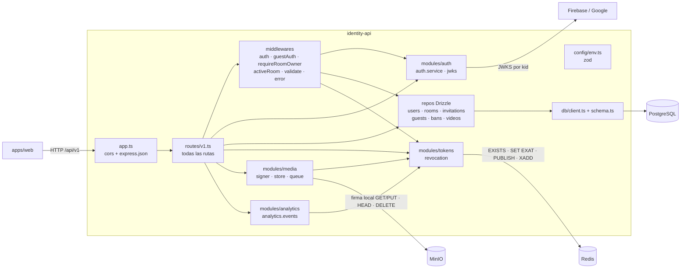

`modules/tokens/revocation.ts` es también el dueño del **cliente Redis** (`getRedisClient`, `lazyConnect`, `maxRetriesPerRequest: 2`): la cola de medios y los eventos de analítica lo reutilizan. Redis, el firmador y el bucket se pueden sustituir en las pruebas (`setRedisClient`, `setMediaSigner`, `setMediaStore`).

| Módulo | Responsabilidad | Archivo |
| :--- | :--- | :--- |
| Arranque | Carga `.env` (`dotenv`) y escucha en `IDENTITY_API_PORT` | `src/server.ts` |
| App | `cors()`, `express.json()`, monta `/api/v1` y el manejador de errores | `src/app.ts` |
| Configuración | Valida el entorno con zod; `FIREBASE_PROJECT_ID` es obligatoria | `src/config/env.ts` |
| Esquema | Tablas Drizzle (fuente de las migraciones de `migrations/`) | `src/db/schema.ts`, `src/db/client.ts` |
| Rutas | Toda la API REST y la orquestación de cada flujo | `src/routes/v1.ts` |
| Auth del Host | `requireAuthHost`: verifica el ID token de Firebase y hace el *upsert* del usuario | `src/middlewares/auth.ts` |
| Auth del invitado | `requireRoomGuest` y `requireRoomHostOrGuest` (decide por el `alg` del JWT) | `src/middlewares/guestAuth.ts` |
| Dueño de la sala | `requireRoomOwner`: `rooms.host_id === req.user.id` (no mira el estado) | `src/middlewares/requireRoomOwner.ts` |
| Sala activa | `requireActiveRoom`: 404 / 410 y deja la sala en `req.room` | `src/middlewares/activeRoom.ts` |
| Validación | `validate(schema)` con zod: 400 con `details` | `src/middlewares/validate.ts` |
| Errores | Último manejador: nunca filtra detalles internos | `src/middlewares/error.ts` |
| Tokens | `issueGuestToken` y `generateHostTicket` (HS256) | `src/modules/auth/auth.service.ts` |
| JWKS | Claves públicas de Firebase por `kid` (caché, 5 peticiones/min) | `src/modules/auth/jwks.ts` |
| Revocación | `token:revoked:{jti}` y evento `REVOKED`; cliente Redis compartido | `src/modules/tokens/revocation.ts` |
| Medios | Firma GET/PUT (endpoint público), `HEAD`/`DELETE` (endpoint interno), `XADD media:uploads` | `src/modules/media/media.signer.ts`, `media.store.ts`, `media.queue.ts` |
| Analítica | `publishAnalyticsEvent`: `XADD analytics:events MAXLEN ~ 100000` que nunca rechaza | `src/modules/analytics/analytics.events.ts` |
| Repositorios | Acceso a cada tabla | `src/modules/{users,rooms,invitations,guests,bans,videos}/*.repo.ts` |

## 3. Cómo funciona, paso a paso

Todas las rutas cuelgan de `/api/v1`. "Firebase" significa `Authorization: Bearer <ID token de Firebase>`; "dueño" añade `requireRoomOwner`.

### 3.1 Login con Firebase (`POST /auth/verify`)

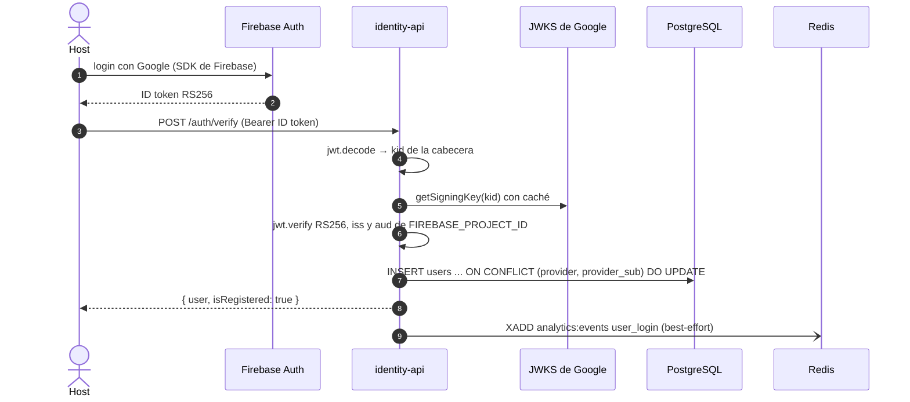

- Sin cabecera, sin `kid`, firma inválida o sin `sub` → **401**. Si falla la base de datos en el *upsert* → **500** `Internal error`.
- `requireAuthHost` hace este mismo trabajo en **cada** ruta de Host, no solo en `/auth/verify`: email, nombre y avatar se refrescan en cada petición autenticada.
- El evento `user_login` lleva `user_id = users.provider_sub` (uid de Firebase), nunca `users.id` ni el email.

### 3.2 Crear sala e invitación

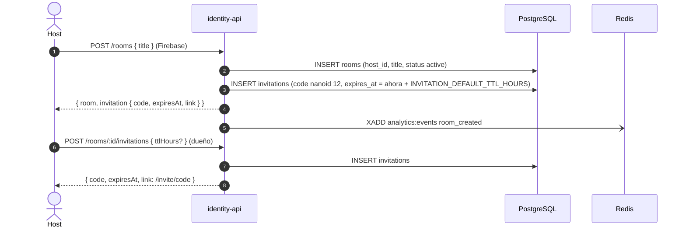

- `title` va de 1 a 150 caracteres; `ttlHours` es un entero de 1 a 720 (30 días).
- `GET /rooms` devuelve solo salas no borradas, cada una con su **última invitación vigente** (no revocada ni vencida), calculada en una sola consulta (`listLatestActiveByRooms`).
- `POST /invitations/:code/revoke` cierra la invitación, pero **no** retira a quien ya entró con ella.

### 3.3 Claim de invitación con `deviceId` (y el 403 BANNED)

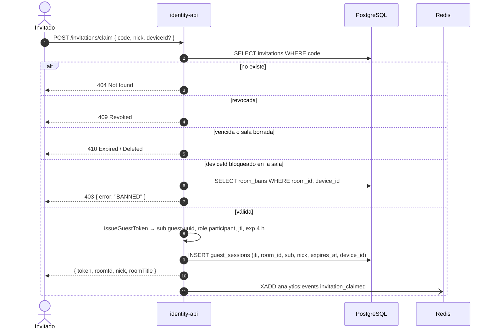

- `deviceId` es un UUID **opcional** que la web genera y guarda en el navegador. Sin `deviceId` no se comprueba ningún bloqueo (clientes viejos).
- La fila de `guest_sessions` se inserta **antes** de responder: un token sin fila no se podría listar ni revocar.
- Cada claim genera un `sub` nuevo (`guest:<uuid>`): el invitado es anónimo y no se vincula con ninguna cuenta.

### 3.4 Sync-ticket y analytics-ticket

Los dos son el **mismo ticket de Host** (`generateHostTicket`): HS256 con `JWT_SECRET`, vida `SYNC_TICKET_TTL_SECONDS` (600 s por defecto) y claims `sub` (`users.id`), `room_id`, `role: host`, `nick`, `jti`, `iss`, `aud`, `exp`, `iat`. Existen porque `sync-core` y `analytics` solo validan JWT simétricos y no conocen los ID tokens de Firebase.

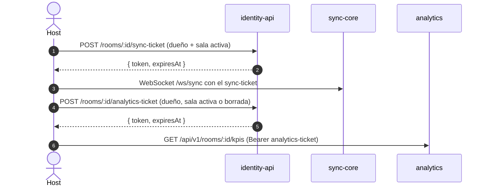

- El `nick` del Host es `displayName`; si no hay, la parte local del email; si no, `Host`. **Nunca** el email completo, porque lo ven todos los invitados.
- El sync-ticket exige `requireActiveRoom` (410 si la sala está borrada). El analytics-ticket **no**: así el Host puede ver los KPIs de una sala ya cerrada.
- `social-core` también acepta el sync-ticket para las acciones de moderación del Host (ver [arquitectura §5](../../docs/arquitectura.md#5-contratos-compartidos-entre-dominios)).

### 3.5 Retirar vs. bloquear a un invitado

Las dos acciones cortan la sesión con el mismo mecanismo de revocación, que es un **contrato** con sync-core, social-core y analytics:

1. `SET token:revoked:{jti} 1 EXAT <exp>`: la marca vive exactamente lo que viviría el token.
2. `PUBLISH room:{id}:sync` con `{ type: "REVOKED", room_id, jti, event_id, position_ms: 0, version: 0, occurred_at, received_at }`: sync-core y social-core cierran las conexiones de ese `jti` con el código **4001**.

La diferencia es que **bloquear** además impide que ese navegador vuelva a reclamar una invitación de la sala.

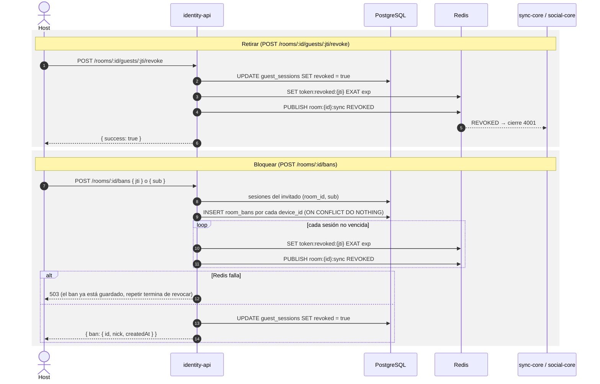

- **Retirar** marca la BD primero. Si Redis falla después, la excepción llega al manejador de errores (**500**) con la sesión ya revocada en BD; repetir la llamada es idempotente y vuelve a escribir la marca y a publicar.
- **Bloquear** guarda el ban **antes** de tocar Redis, así un 503 nunca deja volver a entrar. `{ jti }` lo usa el panel de invitados y `{ sub }` el chat. Se inserta un ban por cada `device_id` distinto de las sesiones del invitado; si ninguna tiene `device_id` (cliente viejo) se guarda uno solo por `sub` (`device_id = NULL`), que corta la sesión pero **no** impide volver a entrar.
- `GET /rooms/:id/bans` y `GET /rooms/:id/guests` nunca devuelven `sub` ni `device_id`. `DELETE /rooms/:id/bans/:banId` desbloquea (los tokens revocados no se reactivan).
- El bloqueo es por **navegador**, no por persona: borrar los datos del navegador, una ventana privada u otro dispositivo lo evaden. Es una barrera contra la reentrada casual ([usuarios-e-identidad §6.6](../../docs/usuarios-e-identidad.md#66-bloquear-a-un-invitado-por-dispositivo)).

Las rutas que aceptan guest token (`requireRoomGuest`) comprueban la revocación en **dos sitios**: `guest_sessions.revoked` y la clave `token:revoked:{jti}`. Si no se puede comprobar (BD o Redis caídos) responden **503**: falla cerrado.

### 3.6 Subida directa a MinIO → `complete` → `XADD media:uploads`

El archivo **nunca pasa por identity-api**: el navegador lo sube a MinIO con una URL PUT firmada (un cálculo SigV4 local, sin red).

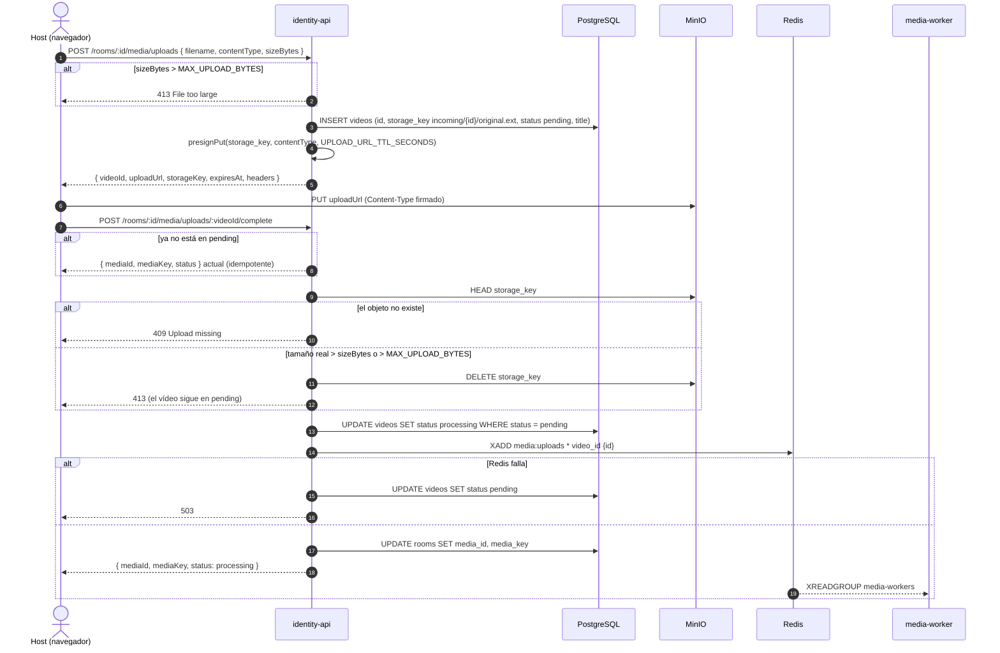

- La extensión de la clave sale del nombre del archivo si es `.mp4`, `.webm`, `.mov`, `.mkv`, `.m4v` u `.ogv`; si no, del `contentType`. El nombre del usuario nunca forma parte de la clave; sí se guarda, sin extensión, como `videos.title`.
- La URL PUT no acota el tamaño: por eso `complete` compara el tamaño real (`HEAD`) con el declarado.
- La transición `pending → processing` es un `UPDATE ... WHERE status = 'pending'`: de dos confirmaciones simultáneas solo una encola.
- Los originales de `incoming/` los borra la regla de ciclo de vida del bucket a los 2 días (`minio-init` en `docker-compose.yml`).

### 3.7 Biblioteca (`GET /videos`) y reuso con `PUT /rooms/:id/media { videoId }`

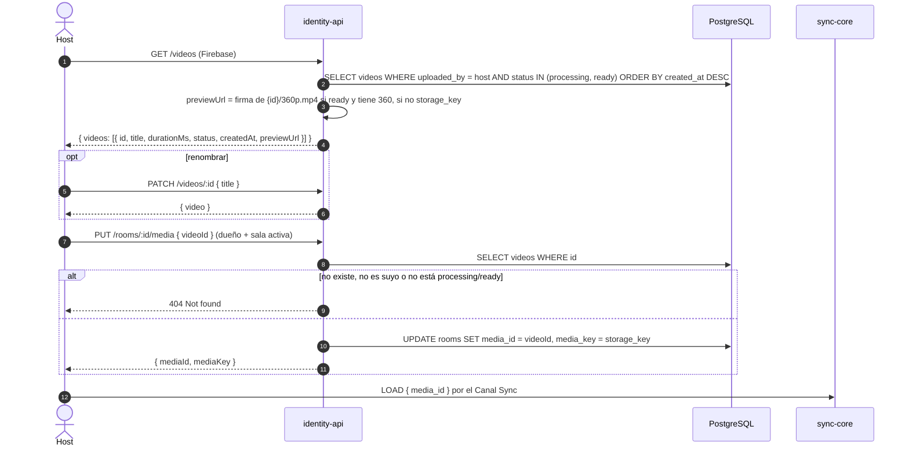

- `PUT /rooms/:id/media` acepta `{ videoId }` **o** `{ mediaKey }` (una clave que ya está en el bucket, con un `mediaId` nuevo), nunca los dos (400).
- Reusar por `videoId` deja `media_id = videos.id`: así el playback sigue resolviendo estado, calidades y Ambilight de ese vídeo.

### 3.8 Playback con calidades y `ambilightUrl`

`GET /rooms/:id/playback` lo pueden llamar el Host dueño (ID token de Firebase) **o** un invitado de la sala (guest token). `requireRoomHostOrGuest` decide mirando el `alg` de la cabecera del JWT: `HS256` → invitado; cualquier otro → Host.

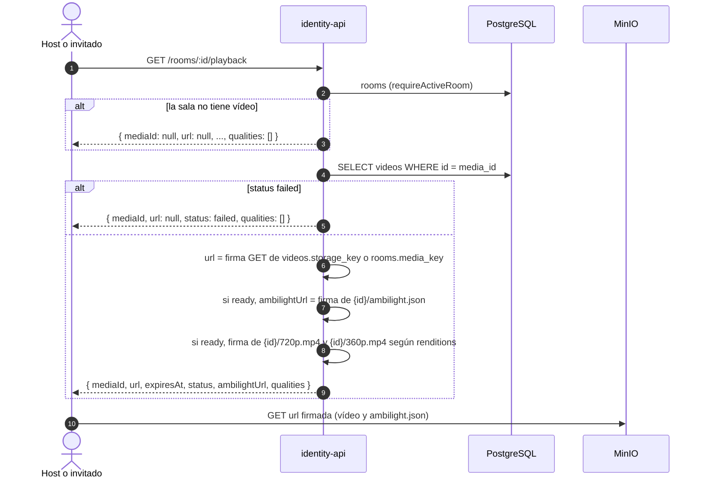

- Mientras el vídeo está en `processing` se reproduce el **original** de `incoming/`; al quedar `ready`, media-worker reescribe `storage_key` a `{id}/source.mp4` y el playback sirve esa versión. Por eso la URL se firma sobre `videos.storage_key` y no sobre `rooms.media_key`.
- `qualities` siempre empieza por `{ id: "source", label: "Original" }` (la misma URL que `url`) y, si el vídeo está `ready`, añade `720p` y `360p` solo si están en `videos.renditions`. `renditions` se lee a la defensiva: solo se aceptan las alturas conocidas `[720, 360]`.
- Todas las URLs comparten el TTL `PLAYBACK_URL_TTL_SECONDS` (1 h). Un vídeo asignado por `mediaKey` manual no tiene fila en `videos`: `status: null` y sin Ambilight ni calidades.

### 3.9 Borrado de sala (`DELETE /rooms/:id`)

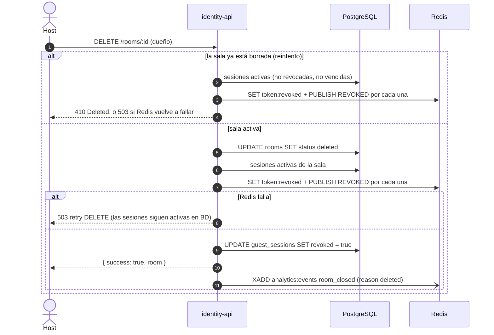

- Es un **borrado lógico** (`rooms.status = 'deleted'`): las filas se conservan y las rutas de la sala responden **410**.
- La BD se marca **después** de Redis: si Redis falla, las sesiones siguen activas en BD y el siguiente `DELETE` las encuentra y termina de revocarlas.
- `room_closed` solo se emite en el primer borrado exitoso, nunca en el reintento ni en el 503. Es el evento que dispara la consolidación de KPIs en `analytics`.

## 4. Estado y datos

### 4.1 Tablas (PostgreSQL)

identity-api es el **dueño del esquema**: las migraciones salen de `src/db/schema.ts` con `drizzle-kit` y viven en `migrations/`. media-worker solo actualiza `videos` (y lee `users.provider_sub`).

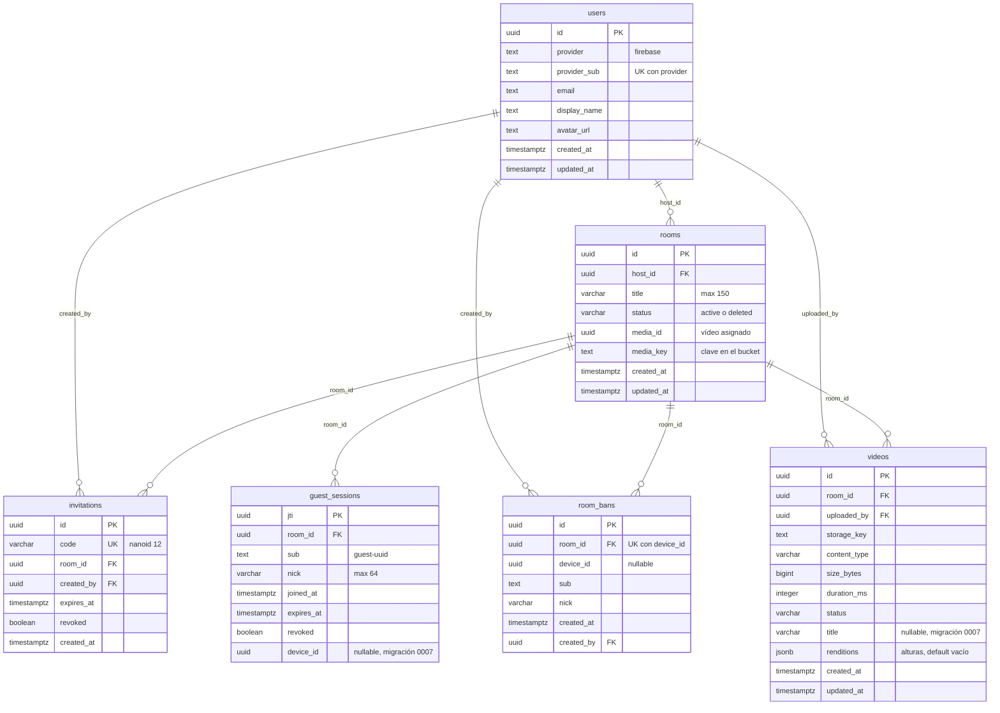

Borrados: `rooms`, `invitations`, `guest_sessions`, `room_bans` y `videos` caen en cascada al borrar su sala o su Host; `videos.uploaded_by` y `room_bans.created_by` pasan a `NULL` si se borra el usuario.

**Estados de `videos.status`:**

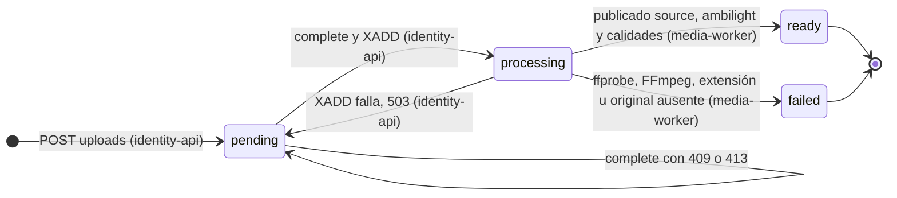

Solo los vídeos en `processing` o `ready` aparecen en la biblioteca y se pueden reusar. Un vídeo que se queda en `pending` (subida nunca confirmada) no es visible; su original caduca en el bucket a los 2 días.

### 4.2 Redis y MinIO

| Clave | Tipo | Escribe | Lee |
| :--- | :--- | :--- | :--- |
| `token:revoked:{jti}` | String con `EXAT` = `exp` del token | identity-api (retirar, bloquear, borrar sala) | identity-api (`requireRoomGuest`), sync-core, social-core, analytics |
| `room:{id}:sync` | Pub/Sub | identity-api publica solo `REVOKED` (el resto es de sync-core) | sync-core, social-core |
| `media:uploads` | Stream | identity-api: `XADD * video_id <id>` | media-worker (grupo `media-workers`) |
| `analytics:events` | Stream, `MAXLEN ~ 100000` | identity-api: `user_login`, `room_created`, `room_closed`, `invitation_claimed` | analytics (grupo `analytics-workers`) |
| `incoming/{id}/original.*` | Objeto MinIO | Navegador (PUT firmado) | identity-api (`HEAD`/`DELETE`), media-worker |
| `{id}/source.mp4`, `{id}/ambilight.json`, `{id}/{720,360}p.mp4` | Objetos MinIO | media-worker | Navegador (GET firmado por identity-api) |

Detalle de los eventos y sus campos en [AGENTS.md › Eventos de analítica](AGENTS.md#eventos-de-analítica) y en el [contrato](../../docs/contrato-eventos-analitica.md).

## 5. Configuración

identity-api corre en `docker-compose.yml` (`Dockerfile` multi-stage y migraciones en el servicio `identity-migrate`); para desarrollar con recarga, `npm run dev` lee `services/identity-api/.env` (plantilla: [`.env.example`](.env.example)). La tabla completa con valores por defecto está en [AGENTS.md › Variables de Entorno](AGENTS.md#variables-de-entorno).

| Grupo | Variables | Notas |
| :--- | :--- | :--- |
| HTTP | `IDENTITY_API_PORT` (8081) | |
| Datos | `DATABASE_URL`, `REDIS_URL` | Los mismos PostgreSQL y Redis de `docker compose` |
| Firebase | `FIREBASE_PROJECT_ID` | **Obligatoria**: sin ella el proceso no arranca (zod) |
| Tokens HS256 | `JWT_SECRET`, `JWT_ISSUER`, `JWT_AUDIENCE` | **Contrato**: deben coincidir con sync-core, social-core y analytics (`.env.example` raíz) |
| Vida de tokens | `GUEST_TOKEN_TTL_HOURS` (4), `INVITATION_DEFAULT_TTL_HOURS` (24), `SYNC_TICKET_TTL_SECONDS` (600) | El último aplica también al analytics-ticket |
| MinIO | `MINIO_ENDPOINT`, `MINIO_PUBLIC_ENDPOINT`, `MINIO_ACCESS_KEY`, `MINIO_SECRET_KEY`, `MINIO_BUCKET`, `MINIO_REGION` | Las URLs se firman con el endpoint **público** (el host va dentro de la firma SigV4); `HEAD`/`DELETE` usan el interno |
| Medios | `PLAYBACK_URL_TTL_SECONDS` (3600), `UPLOAD_URL_TTL_SECONDS` (900), `MAX_UPLOAD_BYTES` (2 GiB) | |

Puertos relacionados: web 5173, PostgreSQL 5432, Redis 6379, MinIO 9000 (API) y 9001 (consola). El CORS de MinIO para el navegador se configura en `docker-compose.yml` (`MINIO_CORS_ALLOW_ORIGIN`).

## 6. Ejecutar y probar

```bash
# Infraestructura (desde la raíz del monorepo)
cp .env.example .env
docker compose up -d postgres redis minio minio-init

# identity-api
cd services/identity-api
cp .env.example .env
npm ci
npx drizzle-kit migrate     # aplica migrations/ sobre DATABASE_URL
npm run dev                 # http://localhost:8081/api/v1/healthz
```

**Gate del dominio** (lo mismo que corre el CI):

```bash
npm ci
npm run typecheck
npx vitest run --coverage   # umbral 85 % en líneas, funciones, ramas y sentencias
```

- Las pruebas unitarias (`tests/*.test.ts`, supertest + mocks de repos) **no** usan PostgreSQL, Redis ni MinIO reales: se inyectan dobles con `setRedisClient`, `setMediaSigner` y `setMediaStore`.
- `npm run test:integration` (`INTEGRATION=1`) recorre el flujo completo contra `docker compose` (PostgreSQL, Redis, MinIO, sync-core y social-core); solo se simula la verificación de Firebase. Con `WAIT_WORKER=1` espera además a que media-worker deje el vídeo en `ready`.
- Si cambias `src/db/schema.ts`, genera la migración con `npx drizzle-kit generate` y commitéala junto con `migrations/meta`.

## 7. Observabilidad y errores

**Formato de error.** Siempre `{ "error": "<texto>" }`. Los 400 de zod añaden `details` (`error.flatten()`). Los 500 son siempre `{ "error": "Internal error" }`: `middlewares/error.ts` registra el detalle y solo deja pasar los 4xx que Express marca como expuestos (JSON mal formado, cuerpo demasiado grande).

| Código | Cuándo |
| :--- | :--- |
| 400 | Cuerpo inválido según zod |
| 401 | Sin token, token inválido o revocado |
| 403 | No es el dueño de la sala, guest token de otra sala, o `BANNED` en el claim |
| 404 | No existe (también para no revelar recursos ajenos, p. ej. vídeos de otro Host) |
| 409 | Invitación revocada o `Upload missing` |
| 410 | Sala borrada o invitación vencida |
| 413 | Vídeo por encima de `MAX_UPLOAD_BYTES` o del tamaño declarado |
| 503 | No se pudo comprobar o escribir una revocación, o encolar en `media:uploads` (falla cerrado) |

**Logs.** `console.error` con un prefijo por componente: `[auth]`, `[guestAuth]`, `[activeRoom]`, `[rooms]`, `[uploads]`, `[bans]`, `[analytics]` y `[error]`. Nunca se registran tokens, emails ni los campos de los eventos de analítica (solo su tipo y el mensaje del error).

**Métricas.** El servicio no expone métricas propias; la salud se consulta en `GET /api/v1/healthz` (`{ status: "ok", service: "identity-api" }`). La actividad de negocio (logins, salas, claims, cierres) llega a `analytics` por `analytics:events`.

## 8. Decisiones de arquitectura

- [ADR 0006 · Tickets JWT HS256 emitidos por identity-api](../../docs/adr/0006-tickets-jwt-hs256-emitidos-por-identity-api.md)
- [ADR 0007 · Revocación por clave Redis y cierre 4001](../../docs/adr/0007-revocacion-por-clave-redis-y-cierre-4001.md)
- [ADR 0008 · Subida directa a MinIO con URL firmada](../../docs/adr/0008-subida-directa-a-minio-con-url-firmada.md)
- [ADR 0009 · Procesamiento asíncrono con Redis Streams](../../docs/adr/0009-procesamiento-asincrono-con-redis-streams.md)
- [ADR 0010 · Eventos de analítica sin PII](../../docs/adr/0010-eventos-de-analitica-sin-pii.md)
- [ADR 0011 · Ambilight precalculado por media-worker](../../docs/adr/0011-ambilight-precalculado-por-media-worker.md)
- [ADR 0013 · Bloqueo de invitados por dispositivo](../../docs/adr/0013-bloqueo-de-invitados-por-dispositivo.md)

## 9. Enlaces

- [AGENTS.md](AGENTS.md): reglas del dominio, tabla completa de la API y variables.
- [Usuarios, identidad y permisos](../../docs/usuarios-e-identidad.md): tipos de usuario, matriz de permisos, ER y tokens.
- [Dominio de Reproducción](../../docs/dominio-reproduccion.md): revocación (§6.6), subida y biblioteca (§6.7).
- [Contrato de eventos de analítica](../../docs/contrato-eventos-analitica.md).
- [Arquitectura](../../docs/arquitectura.md): [vista de componentes y conectores (§4)](../../docs/arquitectura.md#vista-de-componentes-y-conectores) y contratos entre dominios (§5).
